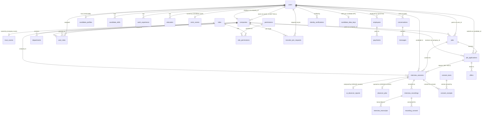

# Rekrut AI — Data Model (Conceptual, for Builders)

*As-is, verified against `origin/dev` @ `e5599900` (2026-10-13). Built on Scout's
extraction pack: physical schema in [./schema.md](./schema.md), migration mechanics in
[./migrations.md](./migrations.md), access control in [./rls-policies.md](./rls-policies.md),
seed/fixture reality in [./seed-data.md](./seed-data.md). This doc is the **conceptual**
layer: what the entities mean, who owns them, and how they live and die. Where the code
could not verify a claim, it says **NOT VERIFIED** — do not build on those lines.*

**Scale, so the model makes sense:** 239 tables, ~205 with at least one FK
(`extraction-notes.md` §2). Three hubs dominate: `users` (~150 children), `jobs` (~47),
`companies` (~31). Most of the 239 are long-tail feature tables; the core graph below is
what a builder must hold in their head.

---

## 1. Entities and relationships

### 1.1 Core ER diagram

FK-verified against [./schema.md](./schema.md) and the creating migrations cited there.
Deliberately FK-less tables (`legal_holds`, `recording_objects`, `biometric_templates`)
cannot appear as relations — they are listed in §1.2 with their logical links.



Reading notes:

- **`interview_sessions` is the unified spine** (migration 129): one row per screening /
  AI interview / practice / human session — `type`, `job_id → jobs`,
  `application_id → job_applications ON DELETE SET NULL`, `candidate_id → users`,
  `company_id → companies`, `config JSONB` (holds, among other things, the
  `biometric_collection` consent flag — see [./rls-policies.md](./rls-policies.md) §6).
  Legacy session tables (`screening_sessions`, `mock_interview_sessions`,
  `scheduled_interviews`, `interview_events`) still exist alongside it; do not model new
  work on them without checking which runtime writes them.
- **Two scores, two names, two subjects** (Sumanth's ruling, 2026-10-13): **OmniScore =
  the candidate score** (`omni_scores`, `001_add_omniscore.js:7`, FK → `users`);
  **Trust Score = the company score** (`trust_scores` + components/history, `002`/`132`,
  FK → `companies`). One scoring architecture, role-specific scores. They are **not**
  interchangeable and neither is global-per-pair today: OmniScore is computed per
  candidate, Trust Score per company. A per candidate×company pairing score is **NOT**
  how the current code works — **NOT VERIFIED** as built; treat pairing-contextual
  scoring as design intent, not current behaviour.
- **`company_ratings` runs candidate → company** (candidate-authored, company-subject,
  `030_omniscore_v2.js:7`) — the reverse direction from most company-owned rows. Flagged
  by Scout; modelled here as joint (§2).

### 1.2 Long-tail families (not in the diagram)

| Family | Tables (representative) | Anchor |
|---|---|---|
| Candidate career/CV | `parsed_resumes`, `cv_uploads` (136), `cv_analyses`/`cv_reviews` (220/221), `portfolio_projects`, `career_diagnoses` (225), `linkedin_profiles` (227), `auto_apply_profiles` (228), `skill_endorsements` (241), `job_alerts` (242), `saved_jobs`, `candidate_embeddings` (008), `candidate_search_index` (p3b) | `users(id)` |
| Scores (sprawl — 9 tables) | `omni_scores`, `omniscore_results` (017), `role_scores`, `score_components`, `score_history`, `score_snapshots`, `score_appeals` + company-side `trust_scores`, `trust_score_components`, `trust_score_history` | candidate / company |
| Assessments | `job_assessments`, `job_assessment_questions`, `job_assessment_attempts` (042), `aptitude_tests`, `coding_templates`, `sandbox_*`, `question_bank` (031), `proctoring_sessions`/`proctoring_events` (120) | `jobs(id)`, candidate |
| Verification | `identity_verifications`, `verification_documents`, `verification_requests`, `document_verifications`, `document_review_queue` (134) | `users(id)` |
| Observer / biometric | `observer_audio_chunks`, `observer_speech_measurements`, `observer_capture_outcomes`, `observer_cohort_allowlist` (257), `biometric_templates` (246 — keyed by opaque `subject_ref`, **no user FK by design**), `biometric_session_map` (246), `biometric_audit_log` (243, append-only) | session / `subject_ref` |
| Post-hire / payroll | `employees` (011), `paychecks`, `payroll_runs`, `payroll_configs`, `onboarding_*`, `candidate_onboarding_data` (019 — holds I-9/W-4/bank fields), `signature_documents`/`signature_requests` (066) | company, `users(id)` |
| Comms | `conversations`, `messages` (072), `communication_*` (040), `notification_queue`/`notification_logs`/`notification_preferences`, `email_queue` | joint / platform |
| Privacy / compliance | `consent_records`/`consent_history` (013) **and** `consent_texts`/`consent_receipts` (244) — two parallel consent families; the **live** one is texts/receipts: `lib/consentService.js:4-5` declares itself "sole owner of `consent_texts` and `consent_receipts`". `data_requests` (DSAR), `data_retention_policies` (013), `legal_holds` (258), `pending_storage_deletions` (252), `compliance_audit_trail` (129), `audit_logs` (013/070), `activity_log` (034) | platform / subject-referencing |
| Platform / content | `ai_prompts` family (039 — **no evidence of runtime use**, extraction-notes §5.10), `api_keys`/`api_key_usage` (223), `country_configs` (027), `events` (016) | none |

**FK-less by deliberate design** (a diagram drawn only from FKs orphans these — extraction-notes §5.8):
`legal_holds` (258 header: a hold must not cascade away; `user_id`/`company_id` are bare
INTEGERs), `recording_objects` (253: `interview_id`/`candidate_id` bare INTEGERs; the
registry is platform-operated), `biometric_templates` (246: opaque `subject_ref` instead
of a user FK — segregation by design), `pending_storage_deletions` (252: `user_id` bare
INTEGER NOT NULL).

---

## 2. Ownership

Ownership = which principal the row is *about / keyed to* (Scout's calls,
extraction-notes §1, FK + creating-migration evidence). Ownership decides who can see it
([./rls-policies.md](./rls-policies.md)) and what erasure may do to it (§3).

| Owner | Entities | Consequence |
|---|---|---|
| **Candidate-owned** | `candidate_profiles`, `candidate_skills`, `work_experience`, `education`, `parsed_resumes`, `cv_*`, `candidate_embeddings`, `candidate_search_index`, `candidate_data_keys`, `omni_scores` + score children, `practice_sessions`, `mock_interview_sessions`, `identity_verifications`, `verification_documents`, `auto_apply_profiles`, `saved_jobs`, `job_alerts`, `user_settings`, `user_memory` | Erasure hard-deletes (§3). Recruiter visibility is a *grant via linkage*, never ownership. |
| **Company-owned** | `companies`, `trust_scores` family, `departments`, `jobs`, `screening_templates`, `interview_flows` (138), `pipeline_automation_rules`, `company_policies`, `offer_templates`, `employees`/payroll, `saved_searches`, `api_keys` | Survives any one candidate's erasure. Access scoped by `company_id` in code. |
| **JOINT (candidate × company pairing)** | `job_applications`, `match_results`, `interview_sessions`, `scheduled_interviews`, `screening_sessions`, `ai_screenings`, `interview_evaluations`, `offers`, `conversations`/`messages`, `ai_observer_reports`, `observer_jobs`, `human_interview_requests` (249), `company_ratings` (candidate-authored, company-subject) | Neither side may unilaterally destroy the shared record. Erasure treats the two sides differently per table — see the `job_applications` callout below. |
| **Platform** | `legal_holds`, `biometric_audit_log`, `compliance_audit_trail`, `audit_logs`, `data_retention_policies`, `pending_storage_deletions`, `recording_objects`, `notification_*`, `question_bank`, `ai_*` ops tables | Subjects are *referenced*, not owners. Audit/consent facts are retained past erasure on purpose (§3). |

### The contested row: `job_applications`

`job_applications` (`002_add_trustscore.js:134`; `candidate_id` + `job_id` +
`company_id`, `UNIQUE(job_id, candidate_id)`) is a **joint row with two owners'
content in one record**:

- **Candidate content:** `cover_letter`, `screening_answers` (022), `resume_url`,
  `omniscore_at_apply`.
- **Company record:** `status` (pipeline state), `recruiter_notes`,
  `screening_score`, `applied_at` — the company's evidence that a hiring process
  happened.

**Erasure consequence — design vs code, stated plainly.** The ruled design (#780,
deferred to the Applications module sprint) is: *redact the candidate content, retain
the skeleton* (status/timestamps/company side) as the company's record. **That design
is not in the shipped code:** `lib/erasureService.js` contains **no** statement against
`job_applications` at all (verified by full read, `origin/dev`), so today an erasure
leaves the **entire** row — cover letter and screening answers included — untouched.
Do not cite #780 as implemented behaviour. The same pattern holds for the 2026-10-13
ruling to DELETE the `auto_apply_profiles` row on erasure (with a consent tombstone):
**ruled, not built** — no `auto_apply` reference exists in `erasureService.js`.

A second live consequence of joint ownership, on the read side: candidates must never
receive the raw row. The candidate-safe projection allowlist
(`routes/candidate.js:2719-2735`, #820) explicitly excludes `recruiter_notes`,
`screening_score`, `omniscore_at_apply`, `resume_url` — see
[./rls-policies.md](./rls-policies.md) §5.

---

## 3. Lifecycle

### 3.1 The three death paths (and the thing that blocks all of them)

Every entity dies — or deliberately doesn't — by exactly one of:

1. **Retention purge** (time-based, scheduled),
2. **Erasure** (subject-driven, DSAR / account deletion),
3. **Cascade** (`ON DELETE CASCADE` from a parent — per-column behaviour is in
   [./schema.md](./schema.md); note self-serve account deletion is a *soft* delete, so
   cascades on `users` do **not** fire on that path — `lib/erasureService.js:147`
   comment).

Blocking all three, per-row: **legal hold** (§3.4).

### 3.2 Retention purge — shipped, dry-run by default

- **Cron:** `server.js:1007-1057` (`startRecordingRetention`, 24 h `setInterval`).
- **Live gate:** `LIVE_PURGE = RETENTION_PURGE_LIVE === 'true' && NODE_ENV ===
  'production'` (`server.js:1011-1012`). The flag set outside production is explicitly
  ignored with a warning, because staging and production share one database
  (`server.js:1013-1017`). **Default is dry-run; the live flip has NOT been approved.**
  In dry-run the observer-audio reconciler is also suppressed (`server.js:1037`).
- **What it calls** (all in `services/euComplianceService.js`, each `dryRun = true` by
  default): `purgeExpiredRecordings` (:654), `purgeRecordingObjects` (:771),
  `purgeExpiredTemplates` (:930), `purgeExpiredObserverReports` (:996),
  `purgeExpiredSpeechMeasurements` (:869), plus a policy-driven sweep (:501-640) over
  `data_retention_policies` rows with `auto_delete = true`, and a 7-day test-artefact
  purge (`server.js:1040`).
- **Policy numbers — verified in code, not just the policy table** (Scout's warning:
  enforcement ≠ policy table; migration 253 exists precisely because the table said
  730 d while 90 d was enforced):

  | Data | Retention | Source |
  |---|---|---|
  | Interview recordings | **90 d** default per-row `retention_expires_at` (`129_interview_sessions_unified.js`, `interview_recordings` DDL); session-linked recordings: **30 d after the hiring decision** (`services/euComplianceService.js:647-648` comment + per-row expiry) | enforced per row by `purgeExpiredRecordings` (:654): storage object deleted first, row soft-deleted (`status='deleted'`), transcript text set to `'[purged]'` (:730) |
  | Vision frames / unified recordings (storage objects) | frames **30 d**, recordings **90 d** | policy rows seeded by `253_recording_objects_registry.js:44-48`; swept via `recording_objects.expires_at` by `purgeRecordingObjects` (:771) |
  | Observer reports | **30 d** | `purgeExpiredObserverReports({ retentionDays = 30 })` (:996) |
  | Observer speech measurements / observer audio | **30 d** | `purgeExpiredSpeechMeasurements` (:869, policy-table fallback 30); `observer_audio` 30 d policy row seeded by `257_observer_capture.js:91-92` |
  | Biometric templates | **90 d** default | `purgeExpiredTemplates({ retentionDays = 90 })` (:930) |
  | Audit logs / assessment results / candidate data / AI decision explanations | 2555 d / 1825 d / 1095 d / policy-driven | seeded `013_compliance_system.js:148-151`; enforced only for `auto_delete` rows in the policy sweep (:501). `candidate_data` anonymises `candidate_profiles` rather than deleting (:588-596) |
  | Inactive embeddings, 24 months | **NOT VERIFIED** | No embeddings-specific retention value or purge was found in `services/euComplianceService.js`, `lib/`, or `server.js` on `origin/dev`. `candidate_embeddings` / `candidate_search_index` are deleted on **erasure** (§3.3) but no time-based inactive-embedding purge is evidenced. Do not quote "24 months" as shipped policy. |

### 3.3 Erasure — `lib/erasureService.js`, `erasePersonalData()` (606 lines)

> **Disposition authority:** this section summarises the shipped mechanism. For
> the formal per-category keep/erase disposition — what must erase, what may be
> kept, on what basis and for how long, and the GAP register (#1120–#1129) —
> see [erasure-keep-erase-table.md](./erasure-keep-erase-table.md) (owner: Lex).

Single choke point for self-serve account deletion (`routes/auth.js:1764-1774`, inside
the deletion transaction) and DSAR fulfilment. Shape: **legal-hold gate first,
fail-closed** (:84-101 — a lookup *error* aborts the erasure with `LegalHoldError`;
callers map it to **409**, GDPR Art. 17(3)(e), `routes/auth.js:1818-1827`), then
crypto-shredding, then per-family handling:

- **Crypto-shred:** `destroyDEK` (:105, via `lib/biometricCrypto.js`) destroys the
  candidate's DEK in `candidate_data_keys` (246), rendering all DEK-encrypted
  biometric data unrecoverable — including in backups. No-DEK users get a destroyed
  **tombstone** row instead (:119-124) so a racing write cannot mint a fresh DEK and
  resurrect erased data.
- **Hard DELETE** (each `WHERE user_id/candidate_id = $1`): `candidate_embeddings`
  (:138), `candidate_search_index` (:142 — a *second* copy of the embedding plus
  plaintext PII), `cv_uploads`/`parsed_resumes`/`candidate_profiles` (:159-167,
  `RETURNING` storage keys), `identity_verifications` (:171), `cv_analyses` (:178),
  `cv_reviews` (:182), `verification_requests` (:189), `verification_documents` (:193),
  `work_experience` (:197), `education` (:201), `candidate_skills` (:205),
  `linkedin_profiles` (:209), `career_diagnoses` (:213), `messages` (:233),
  `user_memory` (:237), `match_results` (:241), `practice_sessions` (:245),
  `screening_sessions` (:249), `interview_transcripts` via recordings subquery (:253),
  `omni_scores` (:261), `role_scores` (:265), `screening_answers` (:271),
  `interview_evaluations` (:275), `interview_composite_scores` (:279),
  `score_components` (:283), `score_history` (:287), `job_recommendations` (:291),
  `ai_observer_reports` (:308), `observer_jobs` (:315), `observer_audio_chunks`
  (:396), `observer_speech_measurements` (:416), `observer_capture_outcomes` (:420).
- **Redact, don't delete:** `recording_consent` — `ip_address`/`user_agent` nulled,
  the consent **fact** retained (Art. 7(1) accountability, Art. 17(3)(b)) (:294-299);
  `interview_sessions.config` — observer-derived keys stripped
  (`- 'observer_transcript' - 'observer_enabled'`), `biometric_collection` consent
  fact retained (:328-332). Session rows themselves are never deleted.
- **Retained with reason:** `conversations` rows are **intentionally NOT deleted** —
  joint data (both parties), retained under **Art. 17(3)(e)** (legal claims); only
  the candidate's own `messages` are deleted (:229-233). `job_applications`: retained
  **in full** today — see the §2 callout; that is a known gap (#780), not a reasoned
  retention.
- **Storage (Phase 2, post-commit — R2/B2 never inside the transaction):** file keys
  collected in Phase 1 are ledgered into `pending_storage_deletions` **inside** the
  transaction (:362-375, :408-414) so a crash between commit and Phase 2 is swept up
  later; `recording_objects` rows are stamped `deleted_at`, not deleted — the registry
  is the audit that the objects existed (:423-427).
- **The account row itself** (`routes/auth.js:1742-1757`): refresh tokens revoked,
  `oauth_connections` + `password_reset_tokens` deleted, then `users` is **soft-deleted
  and PII-scrubbed in place** — `deleted_at = NOW()`, email rewritten to
  `deleted_<id>_<rand>@deleted.local` (frees the address for re-registration), name →
  `'Deleted User'`, `password_hash`/`google_id`/`linkedin_id`/`oauth_provider`/
  `avatar_url` nulled. The tombstone row remains (§4.3).

### 3.4 Legal hold — `lib/legalHold.js` + migration 258

- `legal_holds` (258): `user_id` and/or `company_id`, **no FKs by design**, active
  while `released_at IS NULL`; release is a stamp, never a delete.
- `findActiveHold` (:177-219) resolves subjects including session → candidate/company
  via `interview_sessions`, and — because candidates carry no `users.company_id` — a
  company hold reaches a candidate through their sessions (:149-161). A session that
  cannot be resolved **throws** rather than reading as not-held (:186-191).
- `isHeld` (:238-248) is **fail-closed**: any error converts to `true` (held).
  `anyHoldActive` (:255-268) does the same for unattributable rows (e.g.
  `biometric_templates`, which has no identity column by design).
- **Consulted per-row at every purge/erasure site:** the erasure entry gate (§3.3),
  every retention purge (held rows are skipped and counted as `held_skips` in the run
  log, `server.js:1048-1049`), and as SQL predicates in the policy sweep
  (`services/euComplianceService.js:499-517`).

### 3.5 Lifecycle by family (compact)

| Family | Created by | Lives in | Retention / death |
|---|---|---|---|
| Account | Self-serve signup (`routes/auth.js` register); OAuth (candidates, §4) | `users` + `user_roles` | Soft-delete tombstone on erasure (§3.3); suspended state blocks auth (§4.3) |
| Company | First same-domain employer signup (§4.2) | `companies`, `user_roles` | No company-erasure path evidenced — **NOT VERIFIED** |
| Job | Recruiter-side user (`jobs.user_id` + `company_id`) | `jobs`, `job_embeddings` | Status lifecycle in `chk_jobs_status` ([./schema.md](./schema.md)); no time-based purge evidenced — **NOT VERIFIED** |
| Application | Candidate apply (or auto-apply, `is_auto_applied`/`applied_via`, 219/228) | `job_applications` | Survives candidate erasure in full today (#780 gap, §2) |
| Interview session | Recruiter send / candidate practice / scheduling | `interview_sessions` (+ legacy tables) | Row retained past erasure; observer keys stripped (§3.3); recordings/frames expire per §3.2 |
| Recordings & frames | LiveKit egress / capture pipeline | `interview_recordings`, `recording_objects` registry, R2/B2 objects | 90 d / 30 d (§3.2), storage-before-DB delete order |
| Observer artefacts | Observer worker (`observer_jobs` queue, in-process) | `ai_observer_reports`, `observer_audio_chunks`, `observer_speech_measurements` | 30 d purge (§3.2); deleted on erasure (§3.3); capture is dormant-by-default (Gate A, flag off — substrate in 257) |
| Scores | Scoring engines on profile/interview events | `omni_scores` family / `trust_scores` family | Deleted on candidate erasure (OmniScore side, §3.3); Trust Score erasure path — **NOT VERIFIED** |
| Consent | Candidate action via `lib/consentService.js` | `consent_texts`/`consent_receipts` (live family) | Consent **fact** retained past erasure (Art. 7(1)); receipt PII minimised (§3.3) |
| Panel labelling consent (BR-7) | Panel speaker's own action via `POST /api/interviews/events/:eventId/labelling-consent` (S-D18, #1955) | `event_labelling_consent` (append-only, migration 299) + `panel_consent_snapshot` JSONB on `diarization_jobs`/`diarization_runs` | Rows live with their event/recording under the existing retention clock; on the SUBJECT's own erasure the pipeline enumerates and DELETEs their rows across all events by `user_id` (S-D19, #1956 — IP/UA die with the row); a candidate's erasure never touches panel rows; claim/run snapshots are the documented consent-tombstone exception (keep/erase line E-17) |
| Audit | Everywhere (append-only) | `biometric_audit_log` (trigger blocks UPDATE/DELETE, 243:65-76), `compliance_audit_trail`, `audit_logs` | 2555 d policy for `audit_logs`; biometric log append-only by trigger |

---

## 4. Identity & account model

### 4.1 Two role systems, one drift

There are **two** role representations, and they do not agree:

1. **Legacy:** `users.role` — `CHECK (role IN ('candidate','recruiter','employer',
   'admin','hiring_manager'))` (`047_p2_schema_hardening.js:292-294`). Public signup
   whitelists only `candidate`, `employer`, `recruiter`, `hiring_manager` — `admin`
   can never originate from signup (`routes/auth.js:79-85`).
2. **RBAC:** `roles` / `permissions` / `role_permissions` / `user_roles` (migration
   128), seeded roles: **`owner`, `admin`, `recruiter`, `hiring_manager`,
   `interviewer`, `viewer`** (128, §6) with 21 permissions (§7-8).

**The drift (tracked as #766), verified in 128:** there is **no `employer` role in the
RBAC map at all** — `employer` exists only as a legacy `users.role` value, bridged at
runtime by the legacy fallback in `middleware/rbac.js:93-99` (see
[./rls-policies.md](./rls-policies.md) §3). And `recruiter` in the RBAC map holds
**15 of the owner's 21 permissions** — everything except `billing:*`,
`company:manage`, `members:manage`, `settings:manage`, `compliance:*` (128, §8) —
i.e. near-owner breadth for the most common hiring-side role. Treat both facts as
load-bearing when adding permissions.

**A second, sharper inconsistency:** ownership transfer writes
`users.role = 'owner'` (`routes/company.js:1324`) — a value **outside** the
`chk_users_role` CHECK list above. Either the CHECK is absent/divergent on the live
database or that write fails there; which is true is **NOT VERIFIED** (no live-DB
introspection, per [./schema.md](./schema.md)). Signup, by contrast, never writes
`'owner'` to `users.role` — the creator keeps `employer`/`recruiter` and gets
ownership only via a `user_roles` row (§4.2).

**Ownership truth is `companies.owner_id`** → `users(id)` (`ON DELETE SET NULL`,
`migrate.js:178`), not a role string. Both transfer and signup key off it.

### 4.2 Company creation, join, transfer

- **Creation (employer signup, `routes/auth.js:152-260`):** recruiter-side roles
  (`employer`, `recruiter`, `hiring_manager`) must use a non-free company email
  domain (:97-112) and supply `company_name` (:114-128). If no company owns the
  domain, one is created with the new user as `owner_id`, and — stated as-is — the
  row is stamped verified at creation: `INSERT INTO companies (…, verified_domain,
  is_verified, domain_enforced_at) VALUES (…, true, NOW())` (:234-240). The creator's
  `users.company_id` is set and an `owner` row is inserted into `user_roles`
  (:244-255). **First creator becomes owner; there is no separate verification step
  in this path.**
- **Join (same-domain second user):** if a company already owns the domain, no second
  company is created — a `recruiter_join_requests` row is created, the owner is
  emailed, and the new account returns `202` with `pending_approval: true` and
  `company_id: null` (:160-225). Until approved, `requireApprovedRecruiter`
  (`lib/auth.js:186-214`) blocks recruiter-side users with no `company_id` — **403
  "Account pending approval"** — with a platform-admin bypass (legacy `admin` role or
  an RBAC `admin`/`owner` row).
- **Transfer (S-079, `routes/company.js:1226-1411`):** owner-only (checked against
  `companies.owner_id`, :1245-1247, plus `requirePermission('company:manage')`).
  Target must be in the same company, not suspended, not pending (:1271-1294). The
  swap is **atomic** (single transaction, :1297-1343): `companies.owner_id` updated,
  old owner demoted (`users.role → 'recruiter'`, RBAC `owner` row deleted), new owner
  promoted (`users.role → 'owner'` — see the CHECK inconsistency in §4.1 — RBAC
  `owner` row inserted), both permission caches invalidated (:1345-1347), audit +
  email emitted after commit.

### 4.3 Account states

No single status column exists; state is the combination of `users.company_id`,
`suspended_at` (2026-08-11 migration), and `deleted_at` (231). All transitions below
are enforced in `lib/auth.js` `authMiddleware` (:129-163) unless noted:

```
                 signup (recruiter-side, domain taken)
   (none) ─────────────────────────────► PENDING APPROVAL
     │                                     company_id IS NULL;
     │                                     requireApprovedRecruiter → 403
     │ signup (candidate, or                │ owner approves join /
     │  first-of-domain employer)           │ transfer / assignment
     └──────────────────────────────► ACTIVE ◄──────────────┐
                                          │                   │ reinstate
                          suspended_at    │                   │ (NOT VERIFIED:
                           set (admin)    ▼                   │  no path read)
                                       SUSPENDED ─────────────┘
                                       authMiddleware → 403 ACCOUNT_SUSPENDED (:149-151)
                                          │
   ACTIVE ── DELETE /delete-account ──► ERASED-TOMBSTONE
   (password-confirmed,                 deleted_at set; PII scrubbed in place;
    routes/auth.js:1722-1757)           authMiddleware → 401 ACCOUNT_DELETED (:154-156);
                                        email freed for re-registration;
                                        erasePersonalData() has run (§3.3);
                                        legal hold → whole transition aborts, 409
```

- **Pending approval** is not a column value — it *is* `company_id IS NULL` on a
  recruiter-side account (§4.2). Candidates never enter it.
- **Erasure is blocked, not partial,** under legal hold: the deletion transaction
  rolls back and the route answers 409 (§3.3).
- Whether a tombstoned account can be *restored* (vs re-registering fresh on the
  freed email): **NOT VERIFIED** — no restore path was found in `routes/auth.js`.

### 4.4 Auth methods

| Method | Who | Evidence |
|---|---|---|
| Email + password | Both sides | `routes/auth.js` register/login; bcrypt cost 13 (:140); role-based password policy (`validatePasswordForRole`) |
| Google OAuth | **Candidates only** | New-user flow determines role from email domain (`determineRoleFromEmail`, `routes/auth.js:633-648`); a `recruiter` result is **redirected to email signup** (`oauth_employer_blocked=true`) instead of creating an account (:915-921). Existing-account linking is a separate settings flow. |
| LinkedIn OAuth | **Candidates only** | Same guard, `routes/auth.js:1170-1175` |
| Employer OAuth | **Disabled by product ruling** | The two redirects above are the enforcement. Employer/recruiter accounts are email/password + domain enforcement (§4.2), always. |
| Password reset | Both sides, shared flow | `POST /forgot-password` (:1546) → `password_reset_tokens` → `POST /reset-password` (:1606); reset revokes all refresh tokens (:1649). Reset tokens are also deleted outright on account erasure (§3.3). |
| Sessions | — | JWT access token (15 min, `lib/auth.js:9,13-17`) + rotating refresh-token families (30 d, reuse of a revoked token revokes the whole family, `lib/auth.js:54-121`); OAuth hand-off to the SPA uses one-time `oauth_exchange_codes` (230, 5-minute TTL, `routes/auth.js:684-698`). API keys (`X-API-Key`, SHA-256 lookup) exist as a separate machine auth — `middleware/api-auth.js`. |

---

## 5. NOT VERIFIED register (this doc)

1. Inactive-embeddings 24-month retention — no code evidence found (§3.2).
2. Per candidate×company pairing scoring — design intent; current engines score per
   candidate / per company (§1.1).
3. `users.role = 'owner'` write vs `chk_users_role` CHECK — one of them does not hold
   on the live DB; which is **NOT VERIFIED** (§4.1).
4. Company-erasure path; job time-based retention; Trust Score erasure path; account
   restore path (§3.5, §4.3).
5. Everything live-DB: actual column shapes where duplicate definitions collide,
   whether migrations 252-258 have run anywhere — inherited from Scout's register
   ([./schema.md](./schema.md), [./migrations.md](./migrations.md)).
6. Which legacy session tables are still written by live runtimes vs read-only
   history (§1.1) — modelled as coexisting; per-table liveness **NOT VERIFIED**.

---

**Data documentation pack:** [index](./README.md) · [data model](./data-model.md) · [schema](./schema.md) · [migrations](./migrations.md) · [access control / RLS](./rls-policies.md) · [seed data](./seed-data.md)
