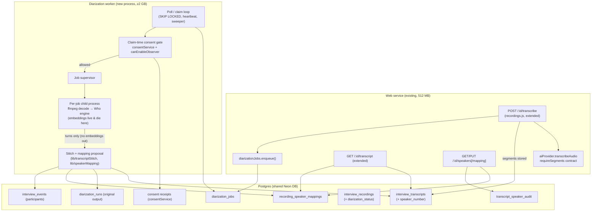
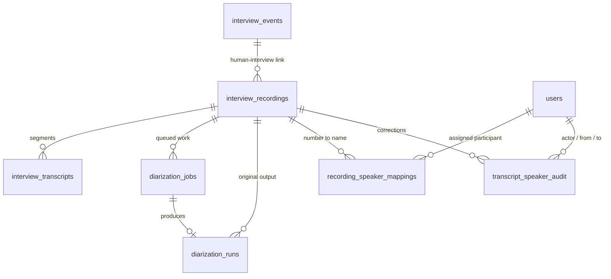

# Speaker-Labelled Interview Transcripts (Diarization) — Architecture

> **Status:** Draft v1 — at Suga's review gate | **Owner:** Sumanth | **Architect:** Rex (Phase 3, Solutioning)
> **PRD:** `docs/sdlc/rekrut-ai-v2/02-planning/speaker-labelled-transcripts/prd.md` (v1.0, Aria) — requirements FR-D01…D21, HA-1…HA-3, NFR-D01…D06, gates G1/G2, open questions OQ-1…OQ-9
> **Lex position:** `LEX-POSITION.md` (2026-10-28) — build requirements BR-1…BR-14 are treated as hard constraints throughout; counsel flags CF-1…CF-5 remain open and are NOT settled by this design
> **Bridge design:** `event-session-bridge-design.md` (Rex, ADR-D06, #1925) — the event→session bridge for the §3.4 consent gate; §3.1/§3.3/§3.4/§4.1/§4.2/§4.4/§9 of this document were reconciled to it in the #1925 build PR
> **Panel-notice design:** `br7-panel-notice-design.md` (Rex, ADR-D07, #1952) — BR-7 panel-speaker notice delivery + own-agreement capture; §4.1/§4.2/§4.4 of this document were reconciled to it (items 3+6 of its §13) in the S-D18 (#1955) build PR, and §3.3/§3.4/§5.3/§6.1/§9 (items 1, 2, 4, 7) in the S-D19 (#1956) build PR
> **Spike:** `~/workspace/spikes/who-diarization/FINDINGS.md` + Step-0 Node-package evidence (§2.1 of this document, measured 2026-10-28 on this VM)
> **Epic:** #1900 — `[EPIC] Speaker-labelled interview transcripts (diarization)`
> **Hard constraints honoured:** no application code in this phase; no schema execution (Neon frozen until Nov 1 — migration is *designed* here, sequenced by Lead); synthetic audio only until G1+G2 clear (BR-1); $0 spend; no vendor contact.

---

## Step-0 evidence — OQ-1 settled before designing (2026-10-28, this VM)

The PRD's first design question was whether the vendor's Node package actually runs on Linux. It was tested, not assumed. Method: `npm install @desert-ant-labs/who` (v4.2.1) in a throwaway directory (`~/workspace/spikes/who-diarization/node-check/`), native entry `@desert-ant-labs/who/native`, run against the spike's existing synthetic test audio and scored with the spike's own scorer (`scripts/score.py`, 10 ms grid, best-overlap mapping). All numbers below are measured on this VM (2 vCPU AMD EPYC, ~8 GB RAM), not vendor claims.

| Question | Measured answer |
|---|---|
| Does it install and run on Linux/Node? | **Yes.** The package ships a prebuilt linux-x64 native core (`libWhoNode.so` + `libLiteRt.so`, loaded via koffi). npm install clean, $0, no build step. A linux-arm64 build also ships. |
| Model download | First `Who.load()` downloads the pinned weights from Hugging Face (~32 MB, litert-int8 set) and verifies them against a SHA-256 manifest (`.dal-meta/manifest`). The downloaded `who.tflite` (sha256 `083ab7ef…`) is the identical file set the spike pulled directly from HF. Model version reported: **v0.3.4**; SDK version **4.2.1**. Weights cache thereafter; warm load 0.4–0.6 s. |
| Output shape | `who.diarize(bytes \| {samples, sampleRate})` → `{ speakerCount, turns: [{ speaker, start, end }] }` (seconds). `JSON.stringify(result)` / `Diarization.fromJSON` round-trip supported. In Node the built-in decoder reads WAV; other formats must be decoded first (our recordings are mp4 — see §3.4). |
| Accuracy, 121.2 s spike audio (single piece) | **Identical to the spike's Python routes:** 2 speakers, 12/12 ground-truth turns matched, **98.59 %** of speech attributed to the correct speaker, 0 % confusion, DER-style total 1.59 %, mean boundary error 0.103 s / 0.052 s. (Best-case synthetic audio — a pipeline proof, never a product accuracy claim; PRD §9.) |
| Cross-piece join, 363.6 s audio (spans the 300 s window boundary) | **The SDK performs the join internally.** Diarized in 10.7 s (≈34× realtime); speaker count stays 2 across the boundary; 36/36 turns matched; 97.81 % correct, 0.01 % confusion, DER-style 2.23 %, one consistent speaker mapping across both pieces. The spike's main unported engineering chunk (voice-print join per `Voices.swift`) is vendor-supplied on this route. Residual degradation vs the single-piece run is partly an artefact of the test file (the same 121 s repeated 3×, abrupt seams). |
| Speed | Diarize: 1.9–3.7 s for 121.2 s of audio across runs (≈33–64× realtime, 2 vCPU); 10.7 s for 363.6 s. A 60-minute recording projects to ~2–4 minutes of inference — comfortably inside NFR-D01's 10-minute budget even with decode and queue time added. |
| Memory | **Peak RSS 829–858 MB at 121 s; 1,065 MB at 364 s** (whole Node process incl. native core). Memory grows with recording duration. The PRD's ≥1 GB floor holds for short recordings only; the worker envelope is set at **≥2 GB** in this design and S-D06 measures 30/60-minute fixtures to fix the final number before any production enablement. A 512 MB instance cannot run this engine — on either route (spike Python harness: 695–752 MB). |
| Telemetry / network (Lex Q3) | The SDK performs a **license check-in**: observed by pointing `DAL_LICENSE_ENDPOINT` at a local listener — `POST /api/v1/license` with JSON `{app:{id:"node"}, installId:<persistent UUID>, model:"who", modelVersion:"v0.3.4", platform:"server", sdk:{name:"desert-ant-core", version:"4.2.1"}}`. **No audio, no embeddings, no end-user data in the payload.** It is best-effort: with the endpoint pointed at a dead address (the vendor package's own test configuration), load and inference run unchanged. The default endpoint URL is compiled into the native binary and was not extracted during this check. The payload self-reports `platform: "server"` — the vendor's own server build naming its own shape; the license *text* question (G1) is unchanged and still the vendor's to answer in writing. |
| Disk artefacts after all runs | The SDK cache directory contains **only** the 5 pinned weight files + manifest. No per-recording files, no embedding stores, nothing keyed to the test audio. Supporting evidence for BR-4/BR-9/OQ-9 (embeddings live inside the inference process only). |

**Route decision (ADR-D01): the vendor Node package is the engine**, run in a per-job child process inside a dedicated worker (§2, §3). The spike's Python port is retained as the documented fallback if G1's vendor answer forbids SDK use or imposes terms Rekrut cannot meet — the engine sits behind an internal interface (§3.5) so the route can swap without touching stitching, mapping, or surfaces.

---

## 1. System Overview

This feature adds a post-recording pipeline to the existing Rekrut monolith: when a recruiter transcribes a completed human-interview recording, transcription now stores **timestamped segments**, a queued **diarization job** works out who spoke when (Desert Ant Labs "Who", server-side), the two are **stitched** into speaker-labelled segments, a deterministic **mapping proposal** attaches participant names where meeting facts support it (and honestly doesn't where they don't), and the existing transcript surfaces render the conversation — with recruiter **correction** of the mapping, audit-logged, and the model's original output always retained.

### System Type

**Pipeline extension inside the existing modular monolith** (Express + React, Postgres). No new service tier, no new datastore, no new queue infrastructure: the job queue is a Postgres table and the worker is a standalone Node process, both copied from the shipped AI Observer pattern (`observer_jobs` + `workers/ai-observer/`). The only new runtime dependency is the vendor's diarization package, isolated in a child process (§3.5).

### Deployment Target

**Render (existing estate).** Web service unchanged in shape. The diarization worker is a separate process needing ≥3 GB RAM (§8.1, final envelope measured by S-D06) — it cannot live in the 512 MB free-tier web instance. Dev/staging proofs run on the team's VM rig. Production placement is a capacity decision for Sumanth under #1837 (§8.3) — this design states the requirement and the options; it does not choose a paid option.

### Scale & Availability

| Dimension | Target | Basis |
|---|---|---|
| Recording length | Up to 60 min (PRD G2/FR-D05) | Interviews run 30–60 min |
| Labelling latency | ≤10 min after transcription for a 60-min recording (NFR-D01) | Measured ≈34–64× realtime inference on 2 vCPU (Step-0) |
| Concurrency | 1 job at a time per worker (memory-bound) | §3.3; back-to-back queueing is linear and visible (J6) |
| Availability posture | Labelling failure never blocks transcription or the report (PRD G3, FR-D04) | Degradation is a designed state, not an error path |
| Data volume | Per recording: segments (tens–hundreds of rows), 1 run row (turns JSONB, KBs), ≤ ~8 mapping rows, audit rows per correction | Trivial against existing transcript storage |

### Key Constraints

- **Gates G1/G2 (Lex BR-1):** the pipeline ships behind `DIARIZATION_ENABLED`, OFF for real recordings until the vendor's written license confirmation (G1) and Lex's consent conditions incl. the BR-6 disclosure/policy fix (G2) are filed. All build and test work runs on synthetic audio (and, for Phase 6 accuracy fixtures, documented internal consented test data only as Lex's position allows).
- **Consent (BR-2/BR-3):** diarization is *biometric* processing (voice-print mechanism) behind the `biometric` consent type, re-resolved live from the DB **at job-claim time** — never from the client, the upload request, or a cache. Decline / withdrawal / Tier 0 objection / Tier 1+2 no-analysis posture → the job cancels and the transcript stays unlabelled, exactly today's behaviour.
- **Embeddings (BR-4/BR-5):** speaker embeddings exist only inside a per-job child process's memory and die with it — in success, failure, and crash alike. They are never written to DB, disk, object storage, logs, metrics, or error reports, and are never compared across recordings. No speaker-identity store exists anywhere in this design.
- **Presentation-only (BR-12):** diarization output attributes transcript text. It has no path — by schema, by module dependency, or by API — into OmniScore, Trust Score, matching, ranking, or any evaluation.
- **Shared database:** staging and production share one Neon database. The v1 schema change is **expand-only** (§4.4); any later contract step is a separate, separately-approved migration, and no migration executes before the Nov 1 Neon unfreeze.

---

## 2. Architecture Pattern

**Chosen:** *Queued worker pipeline inside the monolith* — a Postgres-table job queue + a poll-claim worker process (the AI Observer pattern, S-047), with the ML engine isolated in a per-job child process. Transcription stays in the request path (as today); everything heavier than a DB write leaves the request path (FR-D07).

**Rationale:**
- It is the pattern this codebase already operates for exactly this shape of problem (consent-gated, DB-claimed, heartbeat-supervised background work on recordings/sessions). Nova builds it by imitation, not invention; Quinn tests it against known behaviours (stale-claim recovery, claim-time consent cancellation).
- The child-process boundary is doing legal work, not just engineering work: BR-4's "embeddings destroyed at job end in all outcomes" becomes a *process-lifecycle fact* (the process exits; its memory is gone) rather than a code-discipline promise. Even a worker crash destroys embeddings.
- A DB-table queue needs no new infrastructure ($0, NFR-D03) and inherits the database's transactional claim semantics (`SELECT … FOR UPDATE SKIP LOCKED`, as `observer_jobs`).

**Alternatives Considered:**

| Alternative | Why rejected |
|---|---|
| In-process in the web service (observer's in-process mode) | The engine needs ≥2 GB peak; the web instance is 512 MB. Inference in the web process would OOM the product, not just the feature. Also violates FR-D07's spirit (no inference pressure on the request path). The observer can run in-process because it holds sockets, not a 1 GB model working set. |
| External queue (Redis/BullMQ, SQS) | New infrastructure and a new operational surface for a 1-concurrency workload; the DB queue precedent is proven in this codebase and its claim/consent semantics are already reviewed. Revisit only if labelling volume outgrows a single worker. |
| The spike's Python port as the engine (LiteRT/ONNX graphs driven by our port) | Proven on Linux (spike: 66×/43× realtime, identical accuracy on the single-piece test) — but the cross-piece voice-print join is **unported and untested** there; we would own a research-grade port of a vendor pipeline (~250 lines today, plus the join) forever. The vendor package supplies the join, pins+hash-verifies its own weights (BR-8/BR-9 by construction), and keeps §7 telemetry intact (BR-9). Retained as the documented fallback behind the engine interface (§3.5) if G1's answer forbids SDK use. Recorded dissent: the port has *no* telemetry and no opaque binary; if the vendor's G1 answer makes SDK telemetry a problem Lex cannot accept, the fallback's posture is stronger — the interface keeps that swap cheap. |
| Browser-side diarization (the package's WASM build) | Weights in the browser violate BR-9 (never shipped to clients) and NFR-D05; also the vendor FAQ disputes browser support. Not considered further. |

**Trade-offs accepted:**
- We accept: a vendor binary dependency (opaque Swift core via FFI) and its license/telemetry posture (gated by G1, pinned by BR-8); single-worker throughput (a 60-min job occupies the worker for minutes; back-to-back interviews queue linearly — visible, acceptable for a post-interview artefact).
- We gain: the vendor-maintained full pipeline including the join; hash-verified pinned weights; no second language runtime to operate; the consent/queue/audit machinery is a copy of a reviewed precedent.

---

## 3. Component Design



### 3.1 Transcribe handler extension (`server/routes/recordings.js`)

**Owns:** the trigger. **Does not own:** inference, queueing, consent decisions.

Today (verified on origin/dev): the handler claims the recording (`status='processing'`, #1202 guard), downloads/decrypts the audio in memory, calls `transcribeAudioWithWhisper`, and inserts **one** `interview_transcripts` row (`speaker_identity='unknown'`, 0 → duration). It never deletes prior rows — re-transcription appends (verified: no `DELETE FROM interview_transcripts` outside `erasureService`).

Changes, in order:
1. Call the ASR chain with the segment contract (§3.2) and store **one row per segment** (real `start_time_ms`/`end_time_ms`) — FR-D01.
2. **Replace semantics (FR-D03):** re-transcription deletes the recording's existing segments *and* its diarization artefacts (runs, mappings, audit, timeline state) in the same transaction as the new insert — the visible result is never new text under old labels, and never a duplicated transcript. (This also repairs today's append-on-re-run behaviour for the recordings path.)
3. After the segment insert commits, **enqueue a diarization job** (§3.3) and set `interview_recordings.diarization_status='pending'` — only when (a) segments exist, (b) `DIARIZATION_ENABLED` is on, and (c) the recording is event-linked (human-interview path; session-linked AI-led recordings are out of scope, PRD §3). Enqueue is a DB insert; the HTTP response is unchanged in shape and timing (FR-D07). Enqueue stays event-linked-only; at gate time the worker resolves consent via the event's **governing session** (ADR-D06, §3.4) — enqueue does not need the session link, the gate does.
4. `speaker_identity` column semantics are **unchanged**: new segments are stored with `'unknown'`, exactly as today. Labels are composed at read time from `speaker_number` + the mapping (§3.7), so a correction never rewrites segment rows (FR-D12) and an unlabelled segment renders exactly as it does today (FR-D02/D04).

### 3.2 Segment-capable transcription contract (OQ-5 — resolved from the codebase)

**Verified:** the chain already asks for timestamps almost everywhere; the recordings path throws them away.

| ASR leg (`lib/ai-provider.js`) | Timestamps today |
|---|---|
| `_openaiWhisper` | Requests `response_format=verbose_json` → response carries `segments[]` (start/end/text). The `execute()` wrapper unwraps `_result`, so segments reach the caller — recordings.js simply never reads them. |
| `_groqWhisper` | `verbose_json`, returns the raw result incl. `segments[]`. |
| `_nimASR` (Parakeet v2/v3) | `verbose_json`, returns raw JSON incl. segments as served. |
| `_deepgramSTT` | Explicitly normalizes utterances → `segments: [{id, start, end, text}]`. |
| `_selfHostedSTT` | whisper.cpp via `lib/self-hosted-audio.js` — returns Whisper-compatible JSON. |
| `_cartesiaSTT` | Returns `{ text }` only — **no segments. The one segment-less leg.** |

**Design (no new providers, no new keys, $0 — NFR-D03):**
- `aiProvider.transcribeAudio(buffer, filename, contentType, { requireSegments: true })`: after a leg returns, if `requireSegments` is set and the result lacks a non-empty `segments` array, that leg counts as failed *for this call* and the cascade continues to the next leg. If every leg fails or none yields segments, the call returns null — transcription fails honestly, exactly as an all-legs-down failure does today. Callers that don't pass the flag (mock interviews, quick practice, screening) see **zero behaviour change**.
- Results are normalized at the same boundary to `{ text, confidence, duration, segments: [{ start_s, end_s, text }] }` (seconds → ms at storage). Segment text concatenated in order must equal the transcript text (FR-D01's "segmentation loses no words" is testable against this contract).
- The recordings handler (§3.1) is the only v1 caller of the flag.
- **Known limit, stated plainly:** whole-file ASR calls inherit the providers' file-size limits (e.g. Whisper's 25 MB) — a 60-minute egress mp4 can exceed a given leg's cap, in which case the cascade moves on; this is today's behaviour for transcription generally, not a diarization regression. Chunked ASR is *not* pulled into v1 scope; if Phase 4 finds real recordings failing transcription for size, that is a separate defect story against the transcription path, not a diarization blocker (diarization itself runs locally on decoded audio and has no upload cap).

### 3.3 Job queue (`diarization_jobs` + `lib/diarizationJobs.js`)

**Pattern: a direct sibling of `observer_jobs` / `lib/observerJobs.js`** — same claim query shape (`SELECT … FOR UPDATE SKIP LOCKED`), heartbeat, stale-claim sweeper, cancel-with-reason. Deviations are diarization-specific and listed here so the reviewer doesn't have to diff two systems:

- One row per (recording, transcription generation). Re-transcription supersedes: enqueue inserts a new job and cancels any still-`pending` job for that recording with reason `superseded_by_retranscription`. A claimed/processing job is never cancelled under the worker's feet; instead the completion write is guarded (§3.6) so a stale job's output cannot land on a newer transcript.
- Statuses: `pending → claimed → processing → complete | failed | cancelled`. Cancel reasons are structured strings, mirroring the observer precedent: `consent_blocked_at_claim:<CODE>`, `consent_blocked_at_write:<CODE>`, `superseded_by_retranscription`, `segments_unavailable` (defensive; §3.1 only enqueues when segments exist). Gate `<CODE>`s include the S-D04 set (`NO_SESSION`, `CONSENT_MISSING`, `CONSENT_WITHDRAWN`, `CONSENT_VERSION_STALE`, `CONSENT_UNVERIFIABLE`, `BIOMETRIC_CONSENT_DECLINED`, `BIOMETRIC_CONSENT_UNKNOWN`) plus the ADR-D06 bridge codes (#1925): `NO_GOVERNING_SESSION` (event never bridged / governing session gone), `SESSION_BINDING_MISMATCH` (governing session bound to another candidate/application, or changed between claim and write), `CONSENT_AFTER_RECORDING` (governing receipt granted after the recording started) plus the BR-7 panel-leg codes (S-D19, #1956, ADR-D07): `PANEL_AGREEMENT_MISSING`, `PANEL_AGREEMENT_DECLINED`, `PANEL_AGREEMENT_WITHDRAWN`, `PANEL_AGREEMENT_STALE`, `PANEL_AGREEMENT_AFTER_RECORDING`, `PANEL_AGREEMENT_UNVERIFIABLE`, `PANEL_AGREEMENT_CHANGED`, `PANEL_EXPECTED_SET_CHANGED`, `PANEL_SET_UNRESOLVABLE`, `PANEL_SNAPSHOT_CONFLICT`.
- Retries: a `failed` job may be re-claimed up to `attempt_count < 3` with the error class recorded; deterministic failures (decode error, segments missing) fail without retry. One recording's failure never touches another's job (FR-D07).
- The queue is the operator surface for J6: counts by status are a `GROUP BY` away (§7).

### 3.4 Diarization worker (`workers/diarization/`)

**Owns:** claiming, gating, supervising, stitching, persisting. **Does not own:** consent state (read live from `consentService`), participant identity (read from `interview_events`), or the engine (child process).

- Poll loop every 5 s (observer cadence), heartbeat every 30 s, stale-claim sweep every 60 s (claims stale after 5 min without heartbeat — a crashed worker's job returns to `pending` for re-claim; embeddings, if any existed, died with the crashed child, BR-4).
- **Claim-time consent gate (BR-2/BR-3) — runs before any audio is touched:**
  1. Resolve the recording's session — **two paths (ADR-D06, #1925)**: (a) a direct session link (`interview_recordings.interview_session_id`) resolves as-is; (b) an event-linked recording resolves via its event's **governing session** (`interview_events.interview_session_id`, migration 298 — the session created for that event, against which consent for that interview is captured). No link at all, or a missing event row → cancel `consent_blocked_at_claim:NO_SESSION` (no verifiable consent — the same default-deny as `canEnableObserver` on a null session); an event with no governing session (or a governing session row gone) → `NO_GOVERNING_SESSION`; binding mismatches between the governing session and the event (candidate/application, server-derived only) → `SESSION_BINDING_MISMATCH`, before any consent lookup. On the bridge path the governing receipt must also predate the recording (`granted_at <= interview_recordings.started_at`) — a later grant → `CONSENT_AFTER_RECORDING`, an unprovable precedence (no `started_at`) → `CONSENT_UNVERIFIABLE` — and the allow carries `governing_session_id` + `consent_receipt_id` provenance, persisted on the job at claim and on `diarization_runs` at stitch; the write-time re-resolution compares its governing session against the claim-time one.
  2. `consentService.checkConsentState(sessionId, 'biometric', candidateId)` — live DB, candidate = `interview_events.candidate_id` (bridge path) or the session's candidate (direct path). Anything other than granted-and-current (missing, declined, withdrawn, version-stale) → cancel `consent_blocked_at_claim:<code>`. Consent is never borrowed from a sibling session (ADR-D06: the application-chain option was rejected — privacy BLOCK, security consent-laundering risk).
  3. `canEnableObserver(session)` must also allow (the session-config projection of the same consent, S-070 propagation) — defence in depth using the existing choke point, so diarization and the Observer can never disagree about a candidate's biometric posture.
  4. **Panel leg (BR-7, S-D19 #1956, ADR-D07 — bridge path ONLY; the session path is unchanged):** after the candidate checks pass (candidate codes keep precedence; the leg is never evaluated when they block), every user in the recording's FROZEN expected set (`panel_expected_user_ids`, frozen at recording creation by S-D18 — the live event roster is never consulted) must hold a latest `event_labelling_consent` decision of `granted` under the notice version in force at the recording's `started_at`, decided no later than that start. Missing/declined/withdrawn/stale/after-recording/unverifiable postures block with the `PANEL_AGREEMENT_*` codes of §3.3; an unfrozen set blocks `PANEL_SET_UNRESOLVABLE`. Speaking presence is irrelevant (the gate conditions on the expected set, never on detected speakers). On allow, the worker persists the panel snapshot (frozen set + hash + grant records) write-once on the job at claim — snapshot-and-claim in one transaction under a per-event advisory lock — and on the run at stitch; the write-time re-resolution compares against it (`PANEL_AGREEMENT_CHANGED` / `PANEL_EXPECTED_SET_CHANGED` / `PANEL_SNAPSHOT_CONFLICT`). The transcribe handler's enqueue is a third check: a standing panel block suppresses enqueue (no job row, state `unavailable`). A decline/withdrawal recorded after labels were written purges them via the capture path (runs/mappings/audit deleted, `speaker_number`s cleared, state `unavailable`; the claim snapshot is retained as evidence).
  - A Tier 1+2 session (presence without analysis consent) and a Tier 0 objection both fail step 2/3 by construction — the `biometric` grant is absent in both. The transcript remains unlabelled (BR-3's fallback = today's behaviour).
- **Supervisor / child split:** the worker process never loads the model. Per job it spawns a child (§3.5), streams it the decoded audio, and collects **turns only**. If the child dies, the job fails; the supervisor survives. The supervisor also re-checks consent **at write time** (step 2 repeated immediately before persisting results): withdrawal during a multi-minute job discards the output and cancels `consent_blocked_at_write:<code>` — the diarization analogue of the Observer's mid-session checks.
- **Audio handling (NFR-D05):** the recording is fetched/decrypted through the same `livekitService` paths the transcribe handler uses (in-memory DEK path for `.enc`, GAP-A2). Decode mp4 → 16 kHz mono PCM with `ffmpeg` (present on the dev VM, v8.1.2; a worker-host prerequisite in §8) invoked with stdout piping — **PCM exists only as a buffer in worker/child memory; no temp file of plaintext audio is created** (the stricter of the existing precedents). No new plaintext copies of audio are introduced anywhere in the pipeline.

### 3.5 Engine child process (`lib/diarizationEngine.js` + child entry)

**Owns:** one diarization run. **Does not own:** persistence, consent, mapping.

- Interface (route-independent): input `{ pcmSamples | wavBytes, sampleRate }` → output `{ speakerCount, turns: [{ speaker, start_s, end_s }], engine: { package, sdkVersion, modelVersion } }`. Stitching/mapping consume only this shape, so the Python-port fallback (spike `scripts/run_who.py`, LiteRT route) can implement the same interface if ADR-D01 is ever reversed by a gate outcome.
- Implementation: a small Node child script that imports `@desert-ant-labs/who/native` **pinned at 4.2.1** (exact version, no range — BR-8), loads the model from the provisioned weights cache (§8.2), diarizes, prints the turns JSON to stdout, and **exits**. Voice-print embeddings are computed inside this process by the SDK (for the cross-piece join) and cease to exist when it exits — success, failure, timeout-kill, or crash (BR-4). The supervisor enforces a hard timeout (15 min) and kills the child on expiry.
- The child writes nothing to disk except the SDK's own weights-cache reads. Verified in Step-0: after all test runs the cache held only the pinned weights + manifest.
- SDK telemetry is part of the vendor package and is **never disabled, filtered, or interfered with** (BR-9). Its payload (install UUID, model, version, platform) contains no candidate data (Step-0 observation); the BR-14 privacy-notice disclosure ships in S-D15. If G1's vendor answer requires a different arrangement, that answer lands before enablement, not after.
- Failure taxonomy surfaced to the job: `decode_failed`, `engine_failed`, `engine_timeout`, `engine_oom` (child exit by signal) — recorded on the job and run rows; never in user-facing copy (users see "Speaker labels unavailable", J4).

### 3.6 Stitching + persistence (`lib/transcriptStitch.js`)

**Owns:** turning (segments × turns) into stored, labelled data. **Does not own:** names (that's §3.7) or display (that's §3.8).

1. **Overlap assignment:** each transcript segment is assigned the diarization speaker whose turn has the **maximum time overlap** with the segment's span; the segment's `speaker_number` is set accordingly. Ties/no-overlap → `speaker_number = NULL` (unlabelled segment).
2. **Partial coverage is data, not presentation glue (FR-D15):** segments with no overlapping turn — beyond the diarized range or in diarization gaps — keep `speaker_number = NULL`. The read path renders them without a speaker heading and marks the labelled/unlabelled boundary. Nothing is carried over by implication.
3. **Single-voice honesty (FR-D16):** if the engine returns one speaker, segments get that one number; no second speaker is synthesized anywhere downstream.
4. **Original output retained (FR-D06/D12):** before stitching, the raw engine output is stored verbatim in `diarization_runs` (turns JSONB + engine/model versions + the mapping proposal generated in §3.7). Stitching and later corrections never mutate the run row.
5. **Generation guard:** results persist only if the job is still the newest job for the recording and the transcript segments it read are still the current generation (checked in the write transaction). Otherwise the output is discarded and the job completes as `superseded` — old labels can never land on new text (FR-D03).
6. **Atomicity:** segment `speaker_number` updates + run insert + mapping insert + `diarization_status='complete'` commit in one transaction. A crash mid-job leaves the recording at `processing` with unlabelled segments — a readable, honest state (J4.1), never a half-labelled transcript presented as final.

### 3.7 Numbers → names mapping (`lib/speakerMapping.js`)

**Owns:** the proposal and its persistence. **Does not own:** correction (a human act, §5) or any content analysis — the proposal uses **meeting facts only** (BR-12 fence: no transcript content, no voice characteristics beyond the numbers the engine returned).

**Participant source (OQ-4 — resolved from the codebase):** for an event-linked recording, `interview_events` is the record of who was in the call: `candidate_id` (the candidate), `recruiter_id` (the lead interviewer), `panel_member_ids INTEGER[]` (panel interviewers), names from `users.name` — the same linkage `canAccessRecording` already trusts for authorization. Display roles: candidate → "Candidate", recruiter/panel → "Interviewer". If the event row is missing/unresolvable, the participant list is empty and FR-D10 applies (all numbers, manual assignment).

**Proposal algorithm (deterministic, explainable, stored as `proposed`):**
- Inputs: speaker numbers with per-speaker speaking share and first-speaking order (computed from the turns — used **internally only**; share figures are never exposed in any API response in v1, per BR-12/FR-D21 deferral); participant list (candidate first-class, interviewers as a set).
- Rules, in order:
  1. **1 speaker:** assign to the candidate only if there are no interviewers of record *or* the speaker is the sole voice and participants = 1; in a multi-participant call a single voice is **not** assumed to be the candidate (FR-D16) — it stays unassigned unless exactly one participant exists. *(Deliberately conservative: a lone interviewer doing a voiceover intro must not be labelled as the candidate.)*
  2. **Speaker count == participant count:** rank speakers by speaking share; assign the largest-share speaker to the candidate and the next speaker to the lead interviewer — **but** if the top two speakers' shares are within 10 % of each other, the candidate/interviewer order between them is ambiguous → leave both unassigned rather than guess (the mapping never guesses; FR-D09's spirit applied to the proposal itself). **Panel participants are never auto-assigned (Rex ruling, 2026-10-28, ratifying the S-D08 deviation on #1910):** `panel_member_ids` is an unordered set and no meeting fact ranks one panel member against another, so pairing a speaker to a specific panel member by share rank would be a guess (FR-D09, ADR-D05). Speakers beyond the lead-interviewer slot stay unassigned ("Speaker N") for manual mapping (FR-D10). This cap is revisited only by a superseding ADR that names a meeting fact distinguishing panel members.
  3. **Fewer speakers than participants:** assign the candidate to the largest-share speaker (same ambiguity guard vs the next speaker), the lead interviewer to the next; remaining participants simply have no speaker (they may have been silent — no turns are invented for them).
  4. **More speakers than participants:** assign as in (3) to the top speakers; extra speakers stay "Speaker N" (FR-D09 — an unlisted voice is never forced into a name).
- The proposal persists as one row per speaker in `recording_speaker_mappings` with `state='proposed'`. Reading is never blocked on confirmation (FR-D08); the UI frames proposed names with the standing estimate note (FR-D13).
- **HA-2 degradation switch:** `DIARIZATION_AUTO_NAME` (default on, server-side config). If Quinn's Phase 6 measurement trips HA-2 (<85 % correct on the 2-speaker human fixture), the switch is flipped and the proposal step is skipped entirely — all speakers render as "Speaker N" with manual mapping (FR-D10) — **without a code change**. The panel auto-naming question (OQ-8) is closed for v1 by the rule-2 cap above: panel members are never auto-named, so no panel bar is needed unless a superseding ADR lifts the cap. The switch is global in v1 (per-surface granularity is a Phase 6 decision, recorded in S-D16).

### 3.8 Read path + surfaces (existing pages, extended)

- `GET /:id/transcript` keeps its response shape and **adds**: per segment, `speaker_number` (nullable) and a composed `speaker_identity` display string; top-level, a `diarization` block (§5). Composition rule: segment with a mapped speaker → `"Candidate — <name>"` / `"Interviewer — <name>"`; mapped-to-nobody or unassigned → `"Speaker N"`; `speaker_number = NULL` → the stored legacy value (`'unknown'`) for pre-feature rows, and **no speaker heading** for post-feature unlabelled segments (FR-D15) — the response marks these segments `speaker_number: null, diarization_covered: false` so the client can render the distinction instead of guessing from the string.
  - Why composition keeps the client contract: `recording-playback.tsx` already colours, searches, and labels purely from the `speaker_identity` string (verified) — composed strings flow through that machinery unchanged (FR-D02), and per-segment seek already exists (§5, OQ-6).
- The playback page gains: the standing estimate note beside the transcript (FR-D13), the labelling state banners (J4: "being prepared" / "unavailable"), the partial-coverage boundary marker (FR-D15), the corrected-by line when corrections exist (FR-D11), and the mapping-editor entry point. No new page.
- Candidate surfaces: wherever the candidate can already fetch their transcript (permission unchanged, FR-D19), the same composed labels + note render read-only (§7 of the PRD), with the "raise it with the hiring team" route instead of an editor.

---

## 4. Data Architecture

**Primary store:** the existing Postgres (Neon) — no new datastore. All new structures are additive (expand-only, §4.4).



### 4.1 Changes to existing tables

| Table | Change | Notes |
|---|---|---|
| `interview_events` | **ADD** `interview_session_id INTEGER NULL` REFERENCES `interview_sessions(id)` ON DELETE SET NULL + index (migration 298, #1925/ADR-D06) | The event→session bridge link: the event's governing session. NULL = unbridged (pre-bridge events) → gate blocks `NO_GOVERNING_SESSION`. SET NULL, not CASCADE: deleting a session degrades the link to the blocked posture, never deletes an event. |
| `interview_transcripts` | **ADD** `speaker_number INTEGER NULL` | The diarization lane for a segment. NULL = unlabelled (legacy rows, partial coverage, consent-blocked, failed). `speaker_identity` semantics unchanged (stores `'unknown'` for all new segments; display is composed at read, §3.8). Index `(recording_id, speaker_number)` added for mapping-wide reads. |
| `interview_recordings` | **ADD** `panel_expected_user_ids INTEGER[] NULL`, `panel_expected_hash VARCHAR(64) NULL` (migration 299, S-D18/#1955, BR-7 §6) | The frozen expected panel set, written by `livekitService.createRecordingRecord` at recording creation via `lib/panelLabelling.js`: `recruiter_id ∪ panel_member_ids` minus `candidate_id`, deduped + sorted, plus a plain SHA-256 hash over the full roster triple (DB-only, never API-returned). NULL = pre-299 or non-event recording → the S-D19 gate leg blocks `PANEL_SET_UNRESOLVABLE`. |
| `diarization_jobs` / `diarization_runs` | **ADD** `panel_consent_snapshot JSONB NULL` (migration 299, S-D18/#1955) | Panel-leg gate provenance (frozen expected set + per-user grant records the claim rested on), written by S-D19's gate leg exactly where the governing-session provenance is written; plain snapshot, no FK (298 reasoning). |
| `interview_recordings` | **ADD** `diarization_status VARCHAR(20) NULL`, `diarization_updated_at TIMESTAMPTZ NULL` | Denormalized latest state so list/transcript reads don't join the queue. NULL = feature not applicable / never queued (all pre-feature recordings — renders exactly as today). Internal values: `pending`, `processing`, `complete`, `failed`, `unavailable`. `unavailable` is the internal state for consent-blocked and segments-unavailable outcomes; it is **rendered identically to `failed`** ("Speaker labels unavailable for this recording") so a candidate's consent posture is never signalled to a recruiter as a state (§6.3) — operators distinguish them via the job rows (J6). CHECK constraint mirrors the value set. |

### 4.2 New tables

**`event_labelling_consent`** — BR-7 panel own-agreement capture (migration 299, S-D18/#1955, `br7-panel-notice-design.md` §5.1 as amended by STOP 1 on #1955):
`id` PK · `interview_event_id INT NOT NULL` FK → interview_events **ON DELETE RESTRICT** (privacy B-1: candidate erasure whole-deletes events; CASCADE would silently delete panel speakers' records) · `user_id INT NOT NULL` FK → users ON DELETE CASCADE (backstop only — account deletion tombstones users, `lib/erasureService.js`) · `decision VARCHAR(10)` CHECK(`granted`,`declined`,`withdrawn`) named `chk_event_labelling_consent_decision` · `notice_version VARCHAR(20)` · `decided_at TIMESTAMPTZ DEFAULT NOW()` · `ip_address INET NULL` + `user_agent_hash VARCHAR(64) NULL` (evidence-only, never API-returned) · `created_at`. **Append-only: deliberately NO UNIQUE(`interview_event_id`,`user_id`)** — every decision is a new row; current = greatest `id`. Indexes `idx_event_labelling_consent_event`, `idx_event_labelling_consent_user` (the user index is also the §10 erasure enumeration path; S-D19 owns the erasure step).

**`diarization_jobs`** — the queue (observer_jobs sibling):
`id` PK · `recording_id` FK → interview_recordings ON DELETE CASCADE · `status` CHECK(`pending`,`claimed`,`processing`,`complete`,`failed`,`cancelled`) · `cancel_reason TEXT NULL` (structured: `consent_blocked_at_claim:<CODE>`, `consent_blocked_at_write:<CODE>`, `superseded_by_retranscription`, `segments_unavailable`) · `worker_id` · `claimed_at`, `last_heartbeat` · `attempt_count INT DEFAULT 0` · `governing_session_id INT NULL` + `consent_receipt_id INT NULL` (migration 298, #1925 — gate provenance written at claim for bridge-resolved jobs; plain integers, deliberately no FK: a historical snapshot of what authorized the decision) · `panel_consent_snapshot JSONB NULL` (migration 299, #1955 — panel-leg provenance, §4.1) · `error_class VARCHAR(50) NULL` (`decode_failed`/`engine_failed`/`engine_timeout`/`engine_oom`) · `error_message TEXT NULL` (server-side only; never rendered to users) · `created_at`, `updated_at`.
Indexes: partial index on `(status, created_at)` WHERE status='pending' (claim), partial index on `last_heartbeat` WHERE status IN ('claimed','processing') (sweeper) — same shapes as migration 255.

**`diarization_runs`** — the model's original output, retained for audit (FR-D06/D12):
`id` PK · `recording_id` FK CASCADE · `job_id` FK → diarization_jobs · `engine_package VARCHAR(100)` (`@desert-ant-labs/who`) · `sdk_version VARCHAR(20)` (`4.2.1`) · `model_version VARCHAR(20)` (`v0.3.4`) · `speaker_count INT` · `turns JSONB` (raw `[{speaker, start_s, end_s}]`, verbatim) · `proposed_mapping JSONB` (the §3.7 proposal as generated, before any human correction) · `coverage_end_ms BIGINT` (how far into the recording diarization actually covered — drives FR-D15's boundary) · `governing_session_id INT NULL` + `consent_receipt_id INT NULL` (migration 298, #1925 — the durable authorization record stored alongside the produced labels: exactly which session and receipt authorized processing of that recording) · `panel_consent_snapshot JSONB NULL` (migration 299, #1955 — panel-leg provenance at persistStitch, §4.1) · `created_at`.
**No embeddings column. No voice-print artefact of any kind is stored — by schema, not by convention (BR-4/BR-5).** A reviewer can verify the absence from the migration alone.

**`recording_speaker_mappings`** — the live mapping (what readers see):
`id` PK · `recording_id` FK CASCADE · `speaker_number INT` · `participant_user_id INT NULL` FK → users (NULL = unassigned, renders "Speaker N") · `participant_role VARCHAR(20) NULL` (`candidate`/`interviewer`, snapshot at assignment so a later role change doesn't rewrite history) · `state` CHECK(`proposed`,`confirmed`,`corrected`) · `updated_by INT NULL` FK → users · `created_at`, `updated_at` · UNIQUE(`recording_id`, `speaker_number`).
Corrections update these rows in place (the *display* truth); the original proposal survives in `diarization_runs.proposed_mapping` and every change is audit-logged (FR-D12).

**`transcript_speaker_audit`** — append-only correction trail (FR-D11, BR-11):
`id` PK · `recording_id` FK CASCADE · `speaker_number INT` · `from_user_id INT NULL` · `to_user_id INT NULL` · `actor_user_id INT NOT NULL` FK → users · `action` CHECK(`confirm`,`correct`,`unassign`) · `created_at`. No UPDATE/DELETE path in application code (house pattern for domain audit tables, e.g. `signature_audit_events`).

**`diarization_metrics_daily`** — counts-only aggregate for HA-3 (correction rate) that legitimately survives erasure:
`date DATE PK` · `labelled_count INT` · `corrected_count INT`. No recording or user linkage of any kind; incremented by the worker/correction endpoints at event time. This is the *only* diarization artefact that outlives a recording, and it contains no personal data.

### 4.3 Data flow (one recording, end to end)

1. Recruiter triggers transcription → handler stores timestamped segments (one transaction) → enqueues job, sets `diarization_status='pending'`.
2. Worker claims (SKIP LOCKED) → heartbeat starts → **consent gate** (§3.4) → cancel-or-proceed.
3. Supervisor fetches + decrypts + decodes audio in memory → child diarizes (embeddings exist only here) → child returns turns, exits.
4. Consent re-check → stitch (§3.6): run row inserted (original output), segment `speaker_number`s set, mapping proposal inserted, `diarization_status='complete'` — one transaction.
5. Reads compose labels from segments + mappings. Corrections write mapping rows + audit rows (+ daily corrected_count). Erasure deletes via the E-3 path (§6.4).

### 4.4 Migration sequencing (shared-DB rule)

- **One expand-only migration** (next number after 295 — 296 at design time; Lead confirms at build): adds the two columns, the CHECK, the five tables, and the indexes above. Nothing is renamed, dropped, narrowed, or backfilled. Existing one-row transcripts keep `speaker_number = NULL` and render exactly as today (no backfill — PRD §3 non-goal, OQ-7).
- **Migration 298 (the #1925 bridge, ADR-D06)** — also expand-only, same execution discipline (post-Nov-1 unfreeze, dev → staging → main promotion order): `interview_events.interview_session_id` (nullable FK, SET NULL) + its index, and the `governing_session_id`/`consent_receipt_id` provenance columns on `diarization_jobs` and `diarization_runs`. No backfill; pre-bridge events stay NULL-linked and the gate blocks them `NO_GOVERNING_SESSION` until their governing session is created at room/join time.
- **Migration 299 (BR-7 panel capture, S-D18/#1955, ADR-D07)** — also expand-only, same execution discipline: the `event_labelling_consent` table (§4.2, event FK RESTRICT, no UNIQUE — append-only), the recording freeze columns `panel_expected_user_ids`/`panel_expected_hash` (§4.1), and `panel_consent_snapshot JSONB` on `diarization_jobs`/`diarization_runs`. No backfill; pre-299 recordings stay NULL-frozen and the panel gate leg (S-D19) blocks them `PANEL_SET_UNRESOLVABLE`.
- The migration is **designed now, executed later**: migrations run only after the Nov 1 Neon unfreeze, in the normal dev → staging → main promotion order, sequenced by Lead. This document authorizes no execution.
- **Contract phase (deferred beyond v1, recorded so it isn't forgotten):** if a future version removes the legacy `speaker_identity='unknown'` storage convention or the denormalized status column, that is its own expand → migrate → contract sequence with its own approval — never bundled into v1.

---

## 5. API Design

**Protocol:** REST/JSON on the existing recordings router (`/api/interviews/recordings`), existing auth (`authMiddleware` + `canAccessRecording`). No new audience anywhere (FR-D19). Versioning: additive fields only — existing consumers are unaffected (FR-D02).

### 5.1 `GET /:id/transcript` (extended)

Existing `segments[]` gain (additive):
```json
{ "id": 123, "speaker_identity": "Candidate — Priya Nair", "speaker_number": 1,
  "diarization_covered": true, "text": "…", "start_time_ms": 41000, "end_time_ms": 58200,
  "confidence": 0.93, "highlights": [] }
```
- `speaker_identity` is the **composed display string** (§3.8): `"Candidate — <name>"`, `"Interviewer — <name>"`, `"Speaker N"`, or the legacy stored value for pre-feature rows. The playback client's colour/search/label machinery consumes it unchanged.
- `diarization_covered: false` marks FR-D15's unlabelled range (client renders no speaker heading + the boundary marker).
New top-level block:
```json
"diarization": {
  "status": "complete | processing | pending | unavailable | null",
  "mapping_state": "proposed | confirmed | corrected | null",
  "corrected_by": "A. Recruiter", "corrected_at": "2026-…",
  "speakers": [ { "speaker_number": 0, "label": "Interviewer — Sam Lee", "assigned": true } ]
}
```
- `status` exposes only the four user-visible states of FR-D04 (`pending`, `processing`, `complete`, and `unavailable` covering both failure and consent cases — §4.1). Failure *reasons* are never in the response.
- **No accuracy figure, confidence score, speaking share, or turn count appears anywhere in any response** (FR-D13/D14/D21).

### 5.2 `GET /:id/speakers` (new; mapping-editor data)

- **Who:** users who can correct — the recruiter of record, a panel interviewer of record, or an admin (the `canAccessRecording` owner/panel/admin set). Candidates do **not** get this endpoint (their route is "raise it with the hiring team", §7 PRD).
- **Returns:** per speaker number: current assignment (`participant_user_id`, role, display name, `state`), and a **sample turn** — the text + `start_time_ms` of that speaker's longest early segment (so the corrector can tell voices apart from the transcript itself, FR-D11, without re-listening). Plus the participant list (from `interview_events` + `users.name`) as the assignment options, and the correction history summary (who/when) for the header line.

### 5.3 `PUT /:id/speakers/mapping` (new; correction)

- **Who:** same corrector set as 5.2. Authorship is audit-logged from the session — never from the request body.
- **Body:** `{ "assignments": [ { "speaker_number": 0, "participant_user_id": 42 } , { "speaker_number": 1, "participant_user_id": null } ] }` (`null` = unassign → "Speaker N").
- **Validation (all fail-closed, 4xx with no partial write):** recording exists and caller is a corrector; every `speaker_number` exists in the recording's latest completed run; every non-null `participant_user_id` is a participant of the recording **as frozen at recording creation** (S-D19, #1956, §13 item 7 / security S-4: the source is the recording's `panel_expected_user_ids` ∪ candidate ∪ recruiter, as frozen — an assignee valid when the recording was made stays valid, and a user added to the event afterwards does not become assignable to a recording they were never a captured speaker on; pre-299 recordings carry no freeze and keep the event's current lists as their source) — assigning an arbitrary user is rejected; duplicate assignment of one participant to two speaker numbers is rejected (a person has one voice in one call).
- **Effects (one transaction):** mapping rows updated (`state='confirmed'` when the saved assignment equals the proposal for every speaker and the action is an acceptance; otherwise `'corrected'`), one audit row per changed speaker, `diarization_metrics_daily.corrected_count` incremented if this is the recording's first correction, response = the updated mapping in the 5.2 shape. Effective on next read, for every reader (FR-D11).
- **Idempotency:** re-PUTting the identical mapping is a no-op (no audit rows, no metric change).

### 5.4 Playback seek (OQ-6 — resolved)

Already implemented: `recording-playback.tsx` sets `video.currentTime = segment.start_time_ms / 1000` on segment click (verified, ~L305). With real segments (FR-D01) the existing machinery seeks per turn — **FR-D20 needs no new mechanism**, only verification inside S-D09's acceptance (clicking a late turn in a long recording seeks correctly).

### 5.5 Error handling

Follows the router's existing conventions (`{ error: string }`, 400/403/404/409/500). New specifics: 409 on a mapping PUT against a recording whose labelling is not `complete` (nothing to correct yet); 422-class validation failures are returned as 400 with field detail, matching house style. Diarization-internal failures never surface as API errors on read endpoints — they surface as the honest `unavailable` state (FR-D04).

---

## 6. Security Architecture

### 6.1 Consent & authorization (the Lex BR set, mapped to mechanisms)

| Requirement | Mechanism in this design |
|---|---|
| BR-1 vendor gate | `DIARIZATION_ENABLED` flag, OFF by default; the flag-flip for real recordings is a release-checklist act (S-D17) that requires G1's written vendor confirmation + G2's conditions filed in `docs/sdlc` next to the Lex position. The flag gates **enqueue** (§3.1) — with it off, no job exists and no code path can run the model on a real recording. Synthetic/test environments enable it freely (they hold no real recordings). |
| BR-2 claim-time consent | §3.4 gate: live `consentService.checkConsentState(sessionId, 'biometric', candidateId)` + `canEnableObserver(session)` at claim, repeated at write. Never client-supplied, never cached, fail-closed on any ambiguity (including a missing session link). Cancel reason mirrors the observer precedent: `consent_blocked_at_claim:<CODE>`. |
| BR-3 decline = no run | Same gate: declined/withdrawn/stale, Tier 0 objection, and Tier 1+2 no-analysis posture all present as "no current `biometric` grant" and cancel the job. Fallback output is today's unlabelled transcript — no partial artefact, no penalty state. |
| BR-4 embeddings memory-only | Embeddings exist only inside the per-job child process (§3.5) and die at its exit in all outcomes. Nothing in §4's schema can hold one. No temp/spill file is created by our code (decode is pipe-to-memory, §3.4). Quinn's verification: post-job sweep of worker host + DB finds no embedding artefact (S-D05/S-D16). |
| BR-5 no cross-recording matching | The engine interface (§3.5) takes one recording's audio and returns one recording's turns; there is no API, table, cache, or code path that carries voice data between jobs. The child is spawned per job with no shared state. This is a red line enforced by architecture, not by a reviewer remembering to check. |
| BR-6 disclosure before enablement | S-D15: consent text version bump with the plain-words diarization disclosure + correction of `biometric-policy.tsx`'s "We do not extract … voice measurements" line, in the same change. Enablement (S-D17) is blocked until both are live — the #777 pattern is a named release-gate check. |
| BR-7 all-speaker notice | S-D15: the recording/joining notice for recruiters and panel members carries the same disclosure (their voices are labelled too). **S-D18/S-D19 (#1955/#1956, ADR-D07):** the notice is now DELIVERED to each non-candidate participant on their own screen via the room token's `labelling_notice` field (N-1), each panel speaker's own agreement is CAPTURED per event in `event_labelling_consent` (N-2, append-only, own device/account), and the gate's panel leg (§3.4 step 4) enforces it — a panel decline means NO diarization on that recording while the decliner still joins and is recorded (N-4). |
| BR-8 version pinning | npm dependency pinned exactly (`@desert-ant-labs/who@4.2.1`, no range); weights are the SDK's pinned HF revision, SHA-256-verified by the SDK's manifest on load (Step-0 evidence). No auto-update path exists in the design. Any package/model upgrade is a code change requiring a fresh Lex check before merge (§16 of the license: downloading an update accepts the then-current terms). The pinned versions are recorded on every `diarization_runs` row, so any output is traceable to the exact model that produced it. |
| BR-9 weights security + telemetry honesty | Weights live only in the worker host's access-controlled cache directory; they are never shipped to clients, never served by any API, never copied into the repo. SDK telemetry is left exactly as the vendor built it — not disabled, not filtered (§3.5). If the chosen runtime had no telemetry, that absence would need G1 cover; on this route it does not arise. |
| BR-10 attribution | S-D15: "Powered by Desert Ant Labs" (linked) on the public legal/acknowledgements page + repository documentation credit — the §9 background-service rule — before production enablement. |
| BR-11 labels are estimates, correctable | Standing estimate note on every labelled surface (FR-D13); correction endpoints with audit (§5.2/5.3); the original proposal retained (FR-D12); candidates see the same labels and a correction-request route (§3.8). |
| BR-12 presentation-only fence | §6.2. |
| BR-13 erasure reachability | §6.4. |
| BR-14 privacy notices | S-D15: main privacy policy + biometric policy describe the processing (purpose, embeddings retained: never, labels retained with the transcript under the recording's retention clock, §7 telemetry disclosure) before enablement. |

### 6.2 The presentation-only fence (BR-12 / FR-D14) — enforced three ways

1. **Schema:** diarization artefacts live in diarization-owned tables; no scoring, matching, or evaluation table gains a column fed by them. Speaking-share is computed transiently inside the proposal and stored nowhere (only its *result* — the proposed assignment — is stored).
2. **Module dependency:** stitching/mapping modules import nothing from, and are imported by nothing in, the OmniScore / Trust Score / matching / screening code. S-D14 adds a dependency-direction test (the repo's existing test runner) that fails if any scoring module imports a diarization module or vice versa.
3. **API:** no response field exposes a diarization-derived quantity (no share, no counts, no confidence) — §5.1. A surface that wants a number must come back through a new PRD decision (FR-D21 is explicitly deferred for this reason).

### 6.3 Information leakage review

- **Consent posture:** internal `unavailable` folds consent-blocked and engine-failed into one user-visible string (§4.1) — a recruiter cannot infer "the candidate declined biometrics" from the transcript state. Job-level reasons stay in server-side tables/logs.
- **Labels as allegations:** a wrong label attributes words to a named person (Lex Q3). Mitigations are the estimate framing everywhere (no surface presents a label as verified), correction with audit, and candidate visibility of the same labels — the design deliberately gives the person most affected by a misattribution sight of it and a route to challenge it.
- **Sample turns** in the mapping editor (§5.2) expose transcript text to correctors only — the same users who can already read the full transcript. No new data exposure.
- **Logs/metrics:** job logs carry recording IDs, states, durations, error classes — never audio, transcripts, embeddings, or voice data (BR-4). Error messages from the engine are stored server-side (`error_message`) and never rendered.

### 6.4 Erasure & retention (BR-13 / FR-D18)

- All diarization tables FK to `interview_recordings` with ON DELETE CASCADE, **and** are added explicitly to the E-3 delete path in `lib/erasureService.js` (which today deletes `interview_transcripts WHERE recording_id IN (…)` at ~L894, including the GAP-A session-linked branch) — belt and braces, mirroring how transcripts themselves are handled. The purge/tombstone path is inherited: once the recording/transcript rows are gone or tombstoned, no label data remains reachable (transcript GET already renders `[purged]` as absence; labels compose from rows that no longer exist).
- Correction audit rows for a recording are deleted with it (FR-D18's explicit rule: no label data outlives its recording in any store). The counts-only daily aggregate (§4.2) survives — it contains no personal data and no recording linkage.
- Retention: labels live and die on the recording's existing retention clock (`retention_expires_at`, 90 days default) — diarization introduces no separate retention period and no artefact outside it.

### 6.5 Secrets & supply chain

No new secrets (the engine needs no API key — verified in Step-0: it ran with no `DAL_*` credentials configured). New supply-chain surface is the one pinned npm package (+ its `koffi` native loader and `@desert-ant-labs/core`); pinning + the SDK's own SHA-256 weight verification (§6.1 BR-8) are the controls, and the dependency is isolated to the worker/child so the web service never loads the native binary.

---

## 7. Observability

- **Per-recording state** (J6/FR-D04): `interview_recordings.diarization_status` is visible wherever recording state is managed (S-D12 adds it to the existing recording-management surfaces) — pending / processing / complete / failed / unavailable at a glance.
- **Queue health:** `diarization_jobs` counts by status + oldest-pending age; failed jobs carry `error_class` (decode/engine/timeout/oom distribution is the operational signal). These are plain SQL aggregates on existing admin patterns — no new metrics infrastructure.
- **Timeliness:** job `created_at` → run `created_at` gives the NFR-D01 distribution (p95 ≤ 10 min for 60-min recordings) from table data alone.
- **Accuracy signal (HA-3):** `diarization_metrics_daily` (labelled vs corrected counts) is the standing real-world accuracy proxy; a sustained 1:1 correction rate above 25 % triggers the PRD's accuracy review. Correction *content* is in the audit table; only counts are aggregated.
- **Logging:** worker logs follow the observer's bracketed-prefix convention (`[diarization]`), one line per state transition + job outcome with duration and error class. No audio, text, or voice data in logs (§6.3).
- **Alerting:** v1 relies on the J6 operator surfaces + failure-count visibility (the estate has no paging for background workers today; the Observer sets the precedent). A failed labelling is user-invisible by design (honest unavailable state), so alerting is about trend, not incidents.

---

## 8. Infrastructure and Deployment

### 8.1 Process topology

| Process | Where | Memory | Notes |
|---|---|---|---|
| Web service (existing) | Render web (free tier, 512 MB) | unchanged | Gains: segment storage, enqueue insert, read composition, mapping endpoints. Never loads the engine. |
| Diarization worker (new) | Separate Node process: `node workers/diarization/index.js` | **≥3 GB envelope — FINAL, measured by S-D06** (see the S-D06 amendment below; the provisional figure was ≥2 GB from a 1,065 MB peak at 6 min of audio) | Poll/claim like the Observer's standalone mode; spawns one child per job; concurrency 1. |
| Engine child (per job) | Spawned by the worker | inside the worker's envelope | Loads pinned model from the weights cache; exits after each job. |

**S-D06 amendment (2026-10-28, #1908 — measured on this VM: 2 vCPU, ~8 GB RAM, warm weights cache; synthetic flite-TTS fixtures, ground truth by construction, run through the full worker path — claim/write consent gates → ffmpeg decode → engine child → `diarization_runs` row read back):**

| Fixture (actual duration) | End-to-end latency | Peak RSS, worker process tree (supervisor + ffmpeg + engine child, 250 ms sampling) | Join result (minute 2 vs final minute) | Speakers found |
|---|---|---|---|---|
| 118.2 s | 5.048 s | 862.7 MB | interviewer→0, candidate→1 in both windows; zero cross-overlap | 2 of 2 |
| 1,795.6 s (30 min) | 50.675 s | 1,608.8 MB | interviewer→0, candidate→1 in both windows; zero cross-overlap | 2 of 2 |
| 3,602.5 s (60 min) | **96.681 s** (NFR-D01 limit: 600 s) | **2,314.3 MB** (supervisor-process peak alone: 390.8 MB; an engine-child-only mid-run figure cited here previously was dropped per #1929 M3 — no committed artefact sources it) | interviewer→0, candidate→1 in both windows; zero cross-overlap | 2 of 2 |

**Final production memory envelope: ≥3 GB for the worker process tree.** Basis: the measured 60-minute combined peak (2,314.3 MB) already exceeds the provisional 2 GB figure on its own, and 3 GB holds ~30 % headroom over the measured peak for real-speech variance (memory is driven mainly by audio duration; fixtures are synthetic, so the headroom is deliberate, not decorative). A 2 GB worker instance is therefore NOT sufficient for 60-minute recordings. Latency has ample headroom (96.681 s vs the 600 s NFR-D01 limit). Raw evidence (incl. every engine turn): `docs/sdlc/rekrut-ai-v2/04-implementation/1908-long-recording-proof-results.json`; harness: `scripts/diarization-long-proof.js` + `scripts/generate-diarization-fixtures.py`. One artefact worth knowing: a fixture hard-truncated mid-speech at exactly 120.000 s made the engine emit a single 0.06 s phantom speaker turn at the cut (119.92–119.98 s); fixtures ending at natural turn boundaries show no phantom speaker (AC-3) — stitching (S-D07) assigns segments by maximum overlap, so a sub-0.1 s turn cannot win a segment, but the behaviour is recorded here rather than smoothed over.

### 8.2 Weights provisioning (BR-8/BR-9)

At worker deploy: `Who.load({ directory: <weights-cache> })` on first boot downloads the pinned weights (~32 MB) from Hugging Face and verifies SHA-256s against the SDK manifest; the directory is provisioned on the worker host's persistent, access-controlled storage and reused across restarts (warm load <1 s). Weights are never in the repo, never in the client build, never served. Upgrades = dependency bump PR + Lex re-check (BR-8), which re-provisions the cache deliberately.

### 8.3 Production placement — options stated as facts for Sumanth's #1837 decision

The worker cannot run on the current free-tier web instance (512 MB < measured ~1.1 GB at 6 minutes of audio, and the envelope grows with duration). Options, in increasing capability order — **this design recommends none; the choice is Sumanth's, with #1837**:

1. **Render background worker, paid tier with ≥3 GB RAM** (final envelope, S-D06-measured, §8.1). The estate's first paid worker. Exact tier/price to be confirmed by Relay at purchase time (Render's worker tiers and prices change; the design fixes only the requirement: ≥3 GB, ffmpeg available or installable, persistent disk for the weights cache). Cleanest operationally: same platform, same deploy pipeline.
2. **A second process on an existing larger host** (e.g. the team's VM class machine). $0 new spend if a suitable always-on host exists, but recordings then move off-platform for processing (egress of decrypted audio to another host — a new data-flow Lex would need to see; stated so the trade-off is visible, not hidden).
3. ** Defer production enablement** (the default until decided): the feature ships dark (flag off in production), fully proven on dev/staging rigs, and enables when capacity is funded. This is dependency D2 in the PRD, named at planning time, and it is S-D17's blocking condition alongside G1/G2.

Dev/staging proofs are unaffected by this decision: the VM rig (2 vCPU, ~8 GB) already runs the worker shape — that is where every Step-0 number came from.

### 8.4 Rollout sequencing

1. Migration 296 (expand-only) — **after Nov 1 Neon unfreeze**, dev → staging → main in the normal promotion order (Lead sequences; §4.4). Migration 298 (#1925 bridge, expand-only) follows in the same promotion order.
2. Code ships with `DIARIZATION_ENABLED` OFF everywhere; worker process deployed to staging rig; synthetic-fixture proofs (Quinn JT suites) on dev, then staging.
3. Disclosure/policy change (S-D15) merges before any enablement.
4. Enablement (S-D17) = G1 filed + G2 conditions met + D2 capacity decided + flag flip, as one release-checklist act on Sumanth's word at the production gate.

---

## 9. Architecture Decision Records

### ADR-D01 — Engine route: vendor Node package, per-job child process
**Status:** Decided (Rex, on Step-0 evidence). **Context:** PRD OQ-1; the vendor FAQ contradicts its own HF card/repo about Node support. **Decision:** `@desert-ant-labs/who@4.2.1` (native entry) is the diarization engine, isolated in a per-job child process behind a route-independent interface (§3.5). **Evidence:** §Step-0 — runs on Linux today; accuracy identical to the spike's routes; **the cross-piece join is internal to the SDK** (36/36 turns, consistent mapping across the 300 s boundary); weights pinned + SHA-256-verified by the SDK; telemetry intact (BR-9); no second language runtime. **Alternatives:** the spike's Python port (join unported — we would own it; no telemetry — Lex Q1.4 cuts both ways); raw ONNX graphs (same porting burden, no SDK at all). **Dissent recorded:** the port route avoids an opaque vendor binary and all telemetry; if G1's vendor answer makes SDK use or its telemetry unacceptable, ADR-D01 reverses to the port behind the same interface, accepting the join-porting cost (est. the largest single chunk of S-D05's scope, re-estimated at that time). **Consequences:** binary dependency on vendor platform builds (linux-x64/arm64 ship today); memory envelope driven by the SDK's in-process behaviour (§8.1); model upgrades are gated events (BR-8).

### ADR-D02 — Worker topology: DB-table queue + standalone worker process
**Status:** Decided. **Decision:** `diarization_jobs` Postgres queue + `workers/diarization/` poll-claim worker, copied from `observer_jobs`/`workers/ai-observer` (SKIP LOCKED claim, heartbeat, stale-claim sweeper, structured cancel reasons), supervisor/child split for the engine. **Alternatives:** in-process worker in the web service (rejected: memory, §2); external queue infra (rejected: new infra for a 1-concurrency workload). **Consequences:** operational familiarity; queue latency is poll-bound (5 s — irrelevant at NFR-D01's scale); one more process to deploy (§8.3 is the cost).

### ADR-D03 — Storage: extend + side tables, expand-only
**Status:** Decided. **Decision:** `interview_transcripts` gains `speaker_number`; original output, mappings, audit, jobs, and metrics get their own tables (§4). Display labels are composed at read; segment rows are never rewritten by corrections. **Alternatives:** (a) write resolved names into `speaker_identity` per segment (rejected: corrections would rewrite transcript rows and destroy the original-output guarantee, FR-D12); (b) one JSONB timeline blob on the recording (rejected: segments are the read model the client already consumes; a blob duplicates it and breaks per-segment highlights/seek). **Consequences:** v1 migration is purely additive on the shared DB; the legacy `'unknown'` convention persists in storage (display composition hides it), with any contract step deferred beyond v1 (§4.4).

### ADR-D04 — Segment timestamps: in-chain `requireSegments` contract
**Status:** Decided. **Decision:** the ASR cascade gains an opt-in segment contract (§3.2); segment-less legs count as failed for segment-requiring calls only; no new providers or keys. **Alternatives:** (a) force a single segment-capable provider for recordings (rejected: breaks the cascade's resilience design and the team's $0 provider posture); (b) post-hoc forced alignment of whole-text transcripts (rejected: a second ML pipeline to invent timestamps the ASR already produces). **Consequences:** recordings transcription may cascade past the Cartesia leg; if all legs are down the failure is today's honest transcription failure. Other transcription consumers are untouched.

### ADR-D05 — Mapping proposal: deterministic meeting-facts heuristics, ambiguity → unassigned
**Status:** Decided. **Decision:** §3.7's rules — participants from `interview_events`; share/order priors only; a 10 %-share ambiguity guard leaves speakers unassigned rather than guessed; content is never analysed. **Alternatives:** (a) always assign best-guess (rejected: a guessed name on a hiring record is the exact fabricated-fact failure the founder's honesty standard forbids; FR-D09); (b) no proposal, manual-only (rejected as the *default*: it makes the common 1:1 case clerical; but it remains the HA-2 degraded mode via `DIARIZATION_AUTO_NAME`, one config flip away). **Consequences:** some correct-but-close calls stay "Speaker N" until a human maps them; the correction UX (FR-D11) carries that load by design.

---

### ADR-D06 — Event→session bridge: governing session per event (no consent borrowing)
**Status:** Decided (Rex, #1925; built by Nova in the #1925 PR). **Context:** migration 130's XOR makes human-interview recordings event-linked, while consent receipts key to sessions — the S-D04 gate therefore cancelled every event-linked job `NO_SESSION`, and diarization could never label its main target. **Decision:** each `interview_events` row gains one deterministic link to a governing `interview_sessions` row created for that event (migration 298, expand-only); consent for that interview is captured fresh against that session in the event's own flow; the gate resolves recording → event → governing session and runs the two existing checks unmodified against that one session (§3.4 as reconciled above), with binding checks, temporal precedence (`granted_at <= started_at`), and provenance persisted on the job (claim) and the run (stitch). **Alternatives:** gate-time resolution via the event's application chain — borrowing a sibling session's consent — **rejected**: (privacy engineer) **BLOCK** — a biometric written release is specific to a collection (candidate, encounter, recording, text shown); the 1:N chain is consent shopping, a sibling grant would outvote a decline, and a borrowed receipt breaks revocation lineage; (security reviewer) accept-with-conditions on borrowing, dissent preserved — its biggest-risk finding, *cross-session consent laundering*, independently supports rejection, and its binding/conjunction/temporal/audit conditions are adopted into this 1:1 design where they are cheap. Also rejected: extending `consent_receipts` with an event link (forks the consent machinery into a second keying scheme forever). **Consequences:** event-linked recordings can be labelled only for interviews whose own governing-session consent was granted before recording; legacy events bridge lazily at room/join time; unbridged events keep blocking fail-closed; S-D17 gains one gate item — Lex confirmation of the BR-7 notice basis for non-candidate (interviewer/panel) speakers. Full design: `event-session-bridge-design.md`.

### ADR-D07 — Panel decline means NO diarization on that recording (BR-7)
**Status:** Decided (Rex, #1952 design; capture built by Nova in S-D18/#1955, gate leg in S-D19/#1956). **Context:** speaker labelling templates EVERY voice in the call, but only the candidate's agreement was captured; the BR-7 text rendered only on the recording starter's screen and nobody recorded a panel speaker's own answer (Lex conditions N-1/N-2/N-4 on #1919). **Decision:** (N-4) a panel decline/withdrawal/missing/stale agreement blocks diarization for that recording only — the decliner still joins and is recorded, the interview proceeds, the transcript ships unlabelled; (N-1) delivery is via each participant's own room token + room page; (N-2) capture is a sibling append-only record keyed to the interview EVENT (`event_labelling_consent`, migration 299), with the expected speaker set frozen on the recording at creation and enforced by the gate's panel leg (§3.4 step 4). **Alternatives rejected:** exclusion of the decliner from the recorded session (coerces the agreement N-2 exists to make real — the employment power-imbalance problem; and it fuses recording consent with labelling agreement); per-speaker partial labelling (separating the decliner's voice IS templating it — not a real mode); keying capture to `recording_consent` (two code facts: no recording row exists before recording starts, and that table's `withdrawn` value is wired to egress stop — the two consents must never share a value space). **Consequences:** the gate gains the `PANEL_*` codes (§3.3); snapshots of the authorizing grants are retained as evidence even when a later withdrawal purges the labels; counsel flag CF-6 (BIPA written-release form for panellists) remains Lex/counsel's, landed behind the §5.3-equivalent version registry if ruled. Full design: `br7-panel-notice-design.md`.

## Appendix A — PRD open-question dispositions (OQ-1…OQ-9)

| OQ | Disposition | Where |
|---|---|---|
| OQ-1 Engine route | **RESOLVED with measured evidence** — vendor Node package runs on Linux; route decided (ADR-D01); Python port retained as fallback. | Step-0, §2, §3.5 |
| OQ-2 Worker shape | **RESOLVED in design** — DB-table queue + standalone worker, child-per-job engine; queueing/retries/back-to-back behaviour specified. | §2, §3.3, §3.4, §8 |
| OQ-3 Storage shape | **RESOLVED in design** — extend + side tables; expand-only migration; legacy rows untouched; contract deferred beyond v1. | §4 |
| OQ-4 Participant-list source | **RESOLVED from the codebase** — `interview_events` (`candidate_id`, `recruiter_id`, `panel_member_ids`) + `users.name`, the same linkage `canAccessRecording` trusts. Fallback (missing event) = FR-D10 manual mapping. | §3.7 |
| OQ-5 Timestamp source | **RESOLVED from the codebase** — the chain already returns `verbose_json` segments on 5 of 6 legs; the handler discards them. Design: `requireSegments` contract; Cartesia leg is segment-less and cascades past. No new providers/keys. | §3.2 |
| OQ-6 Playback seek | **RESOLVED from the codebase** — seek-to-segment already implemented (`recording-playback.tsx`, `video.currentTime = start_time_ms/1000`). FR-D20 needs verification only (inside S-D09). | §5.4 |
| OQ-7 Backfill | **CARRIED** — post-v1 founder decision, unchanged. The per-recording job design would support a future backfill without schema change; nothing is built. | PRD §3 |
| OQ-8 Accuracy bars | **CARRIED to Quinn (Phase 6)** — HA-2's 2-speaker bar is set in the PRD; the panel bar is Quinn's on measured evidence. Design hooks supplied: `DIARIZATION_AUTO_NAME` switch (degradation without code change) + engine/model versions on every run for re-scoring. Story S-D16. | §3.7, §7 |
| OQ-9 No accidental voice identity | **RESOLVED in design + Step-0 evidence** — persistence surface enumerated in §4 (no embedding can be stored); SDK cache verified weights-only after all runs; child-process lifecycle is the destruction mechanism; Quinn's post-job sweep verifies in S-D05/S-D16. | §3.5, §6.1 (BR-4/5) |

## Appendix B — Traceability (condensed)

- **FR-D01/D02** → §3.1, §3.2, ADR-D04 · **FR-D03** → §3.1(2), §3.3, §3.6(5) · **FR-D04** → §3.3, §4.1, §5.1, §7 · **FR-D05** → Step-0 (join evidence), §3.5, S-D06 measurement · **FR-D06/D12** → §3.6(4), §4.2 runs/mappings/audit · **FR-D07** → §2, §3.3, §3.4 · **FR-D08/D09/D10** → §3.7, ADR-D05 · **FR-D11** → §5.2, §5.3, §4.2 audit · **FR-D13** → §3.8, §5.1 · **FR-D14** → §6.2 · **FR-D15** → §3.6(2), §5.1 · **FR-D16** → §3.6(3), §3.7 rule 1 · **FR-D17** → §3.5, §6.1 (BR-4/5) · **FR-D18** → §6.4 · **FR-D19** → §5 (existing auth throughout) · **FR-D20** → §5.4 · **FR-D21** → deferred (PRD), fenced by §6.2(3).
- **BR-1…BR-14** → §6.1 table, item by item. **HA-1** → S-D16 · **HA-2** → §3.7 switch · **HA-3** → §4.2 metrics, §7. **NFR-D01** → Step-0 timings + §7 measurement · **NFR-D02** → §8.1 · **NFR-D03** → §3.2, §8 (no per-call fees anywhere) · **NFR-D04** → §3.3 retries, §3.6(5/6) · **NFR-D05** → §3.4 audio handling, §6.1 (BR-9) · **NFR-D06** → §3.8, §5.1.
- **Gates:** G1 (vendor written confirmation) and G2 (Lex conditions incl. BR-6) block **enablement only** (§8.4, S-D17) — never this design, the build, or synthetic testing. CF-1…CF-5 remain counsel's; nothing in this design presumes their answers (the consent design follows the stricter reading throughout, per Lex §2.1).

---

*End of Architecture v1. Companion: `epics-stories.md` (same folder) — stories S-D01…S-D17 under epic #1900. Next step: Suga's review at the Phase 3 gate; on approval, Lead plans the sprint sequence and Nova builds story by story under the standard gates.*
